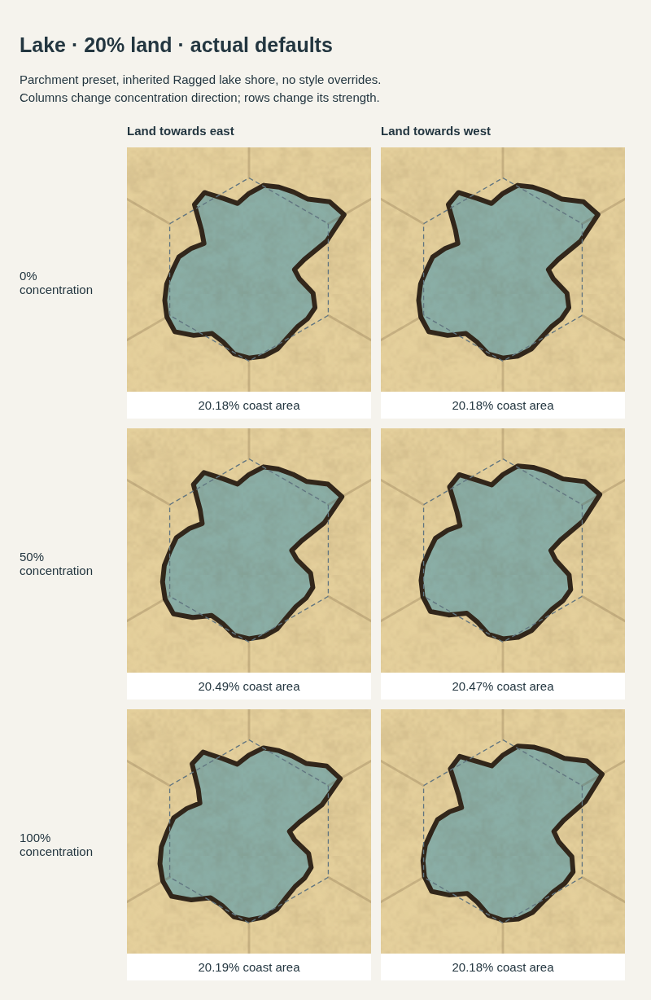

# Single-edge coastal concentration

A coastal hex with one sea-facing edge previously ignored directional concentration: its parallel cut had only one depth, so the area search cancelled the concentration multiplier. The new cut supports independent endpoint depths. It preserves more land at the endpoint towards the selected side, and solves the mean depth to preserve the requested land share.

The endpoint bias is bounded over the whole hex, including projections beyond the edge endpoints, so increasing depth remains a monotone area search. The depth bracket expands when needed for strong concentration and small land targets. Zero concentration retains parallel clipping. Coastal mainland bands use the same directional cut.

## Before and after

Baseline: main immediately before the fix at `937a95cce10e30c5298b089470b9640ad455bec6`. The after renderer is rebased onto `ad0023e`, which includes the merged fix from PR #154. Both renderers receive identical inputs: a 5×5 map, fixed seed, the app’s new-user Parchment preset with no style overrides, inherited Ragged coastal irregularity, and a central coastal hex with exactly one sea-facing edge, to the east. The two selected directions are existing sides 1 (SE) and 5 (NE), which have equal facing relative to that coast. These default-style images replace the earlier forced-Smooth comparisons. No map or hex irregularity is set, and `NEW_USER_STYLE_CHOICE` supplies the preset without overriding textures, water, or grid. The dashed outline marks the edited hex. Each column uses the full scene renderer, spline fitting, and coastline ink.

### 80% land target


### 50% land target


At 100% concentration:

| Land target | Before: SE / NE coast area | After: SE / NE coast area | Before: directional redistribution | After: directional redistribution |
| --- | --- | --- | --- | --- |
| 80% | 79.769% / 79.769% | 79.928% / 79.745% | 0.00 pp | 8.42 pp |
| 50% | 50.271% / 50.271% | 50.139% / 50.103% | 0.00 pp | 10.26 pp |

Redistribution measures the difference in land within the southern half when selecting SE versus NE, expressed as percentage points of the whole hex. It measures where land moves, independently of total land area. Across all 24 before/after scenes, the largest measured coastline-area error is 0.271 percentage points; no scene reports a drawing compromise. Polygon land-share error is below 0.000003 percentage points in these fixtures. Measurements use 256 scanlines of the outlined coastline and include coastline ink. They do not measure every painted pixel.

**Correction to the earlier comparison:** the coloured patches crossing the coastline were caused by repeated SVG clip and pattern IDs in the HTML contact sheet. Each scene exporter starts its IDs at the same value. Embedding several exported SVGs inline let later panels use the first panel’s clip paths. This was a comparison-image defect, not a fill/shoreline mismatch in the standalone app scene. The regenerated sheet embeds each SVG as a separate image document, preserves its XML namespaces, and verifies each panel screenshot byte-for-byte against its standalone render at the same pixel position. All 24 coastal panels pass.

The comparison script checks cancellation on the baseline polygon, preservation of the zero-concentration coast, and movement towards the selected side at both 50% and 100% strength. Ragged fitting can alter local details and need not move each half monotonically with strength. The asymmetric geometry survives the existing downstream fitter, whose cache key already includes the changed paths and anchors; no additional spline constraint is needed for these cases. This change uses the existing six-side selector and does not introduce a separate corner selector. A direction perpendicular to the coastal edge has no tangential skew.

## Lakes

Testing the actual-default lake renderer found two independent issues:

- At low land shares, the fitted mean inset could become negative. Multiplying that signed inset by the concentration factor reversed the selected direction. Directional bias now uses the original positive inset and is added independently of the fitted mean.
- Lake area fitting approximated shoreline ink using length × stroke reach and stopped after six passes. It now measures the actual land silhouette and ink coverage, with up to twelve passes for strongly concentrated cases.

The two new lake regressions fail against pre-fix main and pass after these changes. Browser validation covers 54 Parchment/default-Ragged lake scenes: 20%, 40%, and 80% land, all six directions, and strengths 0%, 50%, and 100%. Every lake fill uses the same path as its outline. All targets are within one percentage point; the largest measured error is 0.500 percentage points. Zero concentration ignores direction, and nonzero concentration preserves more land towards the chosen side at all three shares. All 18 lake gallery panels also match their standalone screenshots byte-for-byte.



[40% land lake gallery](lake-concentration-comparison-40.png) · [80% land lake gallery](lake-concentration-comparison-80.png) · [Lake measurements](lake-concentration-results.json).

## Validation

- `npm run typecheck` passed.
- All 64 test files passed, run individually with `node --import tsx test/<file>.test.ts` because the sandbox prevents the `tsx` CLI IPC listener.
- Six coast-orientation regressions and two new actual-default lake regressions passed.
- Browser assertions cover 24 coastal scenes and 54 lake scenes, including area accuracy, direction, fill/outline agreement for lakes, and zero concentration.
- All 42 gallery panels match their standalone screenshots byte-for-byte. Separate SVG image documents prevent cross-panel clip and pattern collisions.

Raw coastal measurements: [coast-concentration-results.json](coast-concentration-results.json).

## Reproduce

From the repository root, with dependencies installed:

```sh
mkdir -p work/coast-concentration/baseline
git archive 937a95cce10e30c5298b089470b9640ad455bec6 | tar -x -C work/coast-concentration/baseline
ln -s "$(pwd)/node_modules" work/coast-concentration/baseline/node_modules
node scripts/coast-concentration-comparison.mjs --baseline-ref 937a95cce10e30c5298b089470b9640ad455bec6
```

The browser script uses the repository's Playwright browser helper. Where the runtime supplies an external driver and browser, append `--driver /path/to/playwright-core/index.mjs --chromium /path/to/chromium`. PNG comparisons, HTML contact sheets, and `results.json` are written under `work/coast-concentration/`. No live server or external browser requests are needed.

To reproduce the lake checks and galleries:

```sh
node scripts/lake-concentration-validation.mjs
```

It supports the same `--driver`, `--chromium`, and `--output` options.
