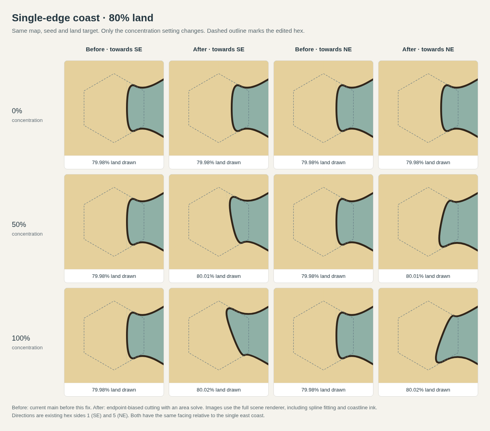
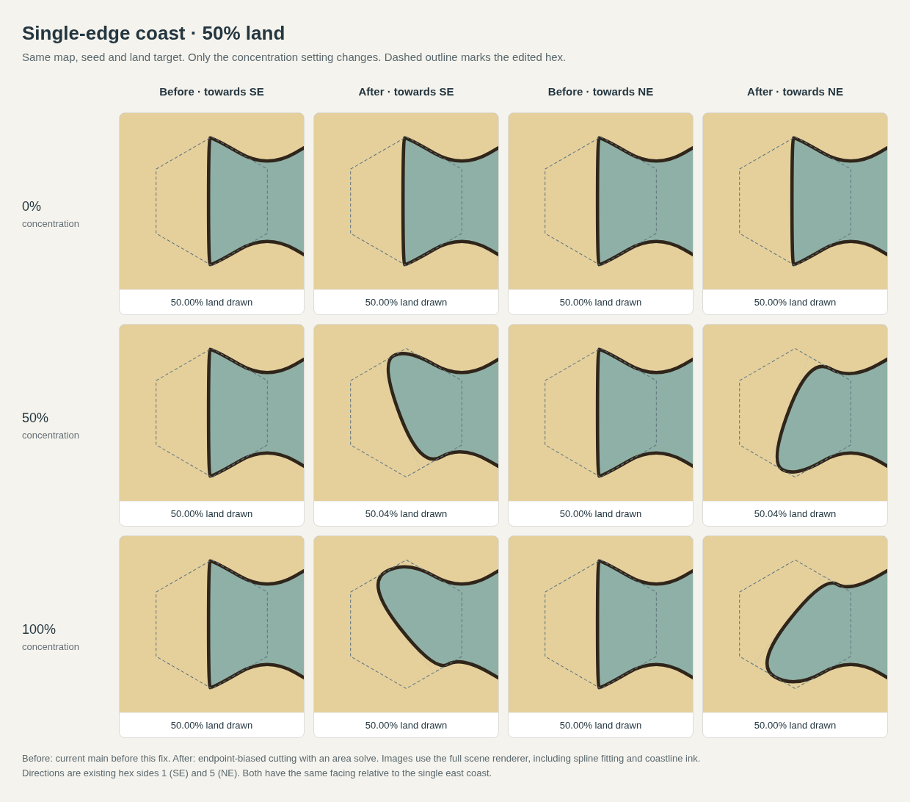

# Single-edge coastal concentration

A coastal hex with one sea-facing edge previously ignored directional concentration: its parallel cut had only one depth, so the area search cancelled the concentration multiplier. The new cut supports independent endpoint depths. It preserves more land at the endpoint towards the selected side, and solves the mean depth to preserve the requested land share.

The endpoint bias is bounded over the whole hex, including projections beyond the edge endpoints, so increasing depth remains a monotone area search. The depth bracket expands when needed for strong concentration and small land targets. Zero concentration retains parallel clipping. Coastal mainland bands use the same directional cut.

## Before and after

Baseline: current main at `849f12f7ff5b6e8bf0048816d57d27f1f93ab101`. Both renderers receive identical inputs: a 5×5 map, fixed seed, Smooth coast, and a central coastal hex with exactly one sea-facing edge, to the east. The two selected directions are existing sides 1 (SE) and 5 (NE), which have equal facing relative to that coast. The dashed outline marks the edited hex. Each column uses the full scene renderer, spline fitting, and coastline ink.

### 80% land target



### 50% land target



At 100% concentration:

| Land target | Before: SE / NE land drawn | After: SE / NE land drawn | Before: directional redistribution | After: directional redistribution |
| --- | --- | --- | --- | --- |
| 80% | 79.982% / 79.982% | 80.016% / 80.016% | 0.00 pp | 7.10 pp |
| 50% | 49.999% / 49.999% | 49.999% / 49.999% | 0.00 pp | 17.98 pp |

Redistribution measures the difference in land within the southern half when selecting SE versus NE, expressed as percentage points of the whole hex. It measures where land moves, independently of total land area. Across all 24 before/after scenes, the largest measured rendered-area error is 0.037 percentage points; no scene reports a drawing compromise. Polygon land-share error is below 0.000003 percentage points in these fixtures. Rendered measurements use 256 scanlines and include coastline ink.

The comparison script also checks that baseline concentration is inert, zero concentration preserves the coast, and increasing strength moves more land in the selected direction. The asymmetric geometry survives the existing downstream fitter, whose cache key already includes the changed paths and anchors; no additional spline constraint is needed for these cases. This change uses the existing six-side selector and does not introduce a separate corner selector. A direction perpendicular to the coastal edge has no tangential skew.

## Validation

- `npm run typecheck`
- All 61 test files passed, run separately with `node --import tsx test/<file>.test.ts` because the sandbox prevents the `tsx` CLI IPC listener.
- Six orientation regressions in `test/coastConcentration.test.ts`: opposite directions, zero concentration, multiple land shares including 0%, 1%, and 99%, exact polygon coverage, and redistribution after smoothing and coupled area fitting.
- Browser comparison assertions for both 50% and 80% targets, two directions, three strengths, and both implementations.

Raw measurements: [coast-concentration-results.json](coast-concentration-results.json).

## Reproduce

From the repository root, with dependencies installed:

```sh
mkdir -p work/coast-concentration/baseline
git archive 849f12f7ff5b6e8bf0048816d57d27f1f93ab101 | tar -x -C work/coast-concentration/baseline
ln -s "$(pwd)/node_modules" work/coast-concentration/baseline/node_modules
node scripts/coast-concentration-comparison.mjs --baseline-ref 849f12f7ff5b6e8bf0048816d57d27f1f93ab101
```

The browser script uses the repository's Playwright browser helper. Where the runtime supplies an external driver and browser, append `--driver /path/to/playwright-core/index.mjs --chromium /path/to/chromium`. PNG comparisons, HTML contact sheets, and `results.json` are written under `work/coast-concentration/`. No live server or external browser requests are needed.
