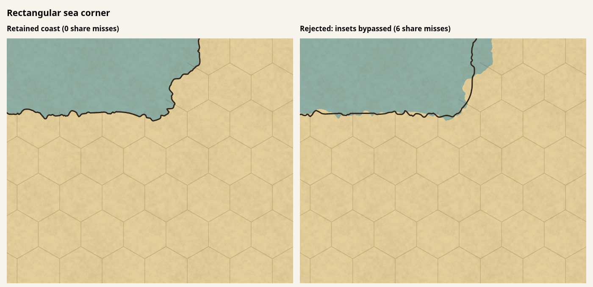

The next coastline-shape change must replace the initial construction and its fill correspondence together. Simply removing the per-hex insets does not produce a usable coast with the current bounded spline fit.

Two experiments were rejected; neither is in the renderer:

- Applying silhouette smoothing before allocating remaining movement to broad features brought back the generated map's edge-share miss and increased its tight-corner count from 64 to 71.
- Bypassing ordinary `inset` targets during smooth construction, while retaining split passages, explicit concentration and protected joins, left 68 share misses on the generated map, 20 on the painted continent and 6 on the rectangular corner map. It also separated fill from coastline ink in the corner render. Removing the per-hex starting shape therefore needs corresponding changes to fill construction and enough continuous fitting movement to reach the requested areas.

These are the same realistic fixtures, default style and path metrics described in PR #172. Share misses count `land drawn` compromises, with the existing ±2.5 percentage-point tolerance. The experimental counts came from one deterministic render per map; their cold timings are not performance evidence.

The left panel is the retained coast with zero share misses. The right panel is the rejected experiment with six share misses across the map; its fill/ink disagreement is also visible. Both panels are actual Chromium renders of the exported SVG at the same crop and scale. This is diagnostic evidence, not a shipped before/after improvement.

The retained checkpoint instead enables the existing scanline-union cache during initial area fitting. Adjacent hexes reuse the land-and-stroke union at each sampled row, retaining the same 96-line integration and geometric constraints. Compared with `bb3a8ff`, all three fixtures keep zero share misses and identical sharp-point, tight-corner and straight-run counts. The initial hex-aligned outline remains unresolved.

In a rotating five-run generated-map comparison after two warm-ups, the initial-fitting phase averaged 1,079 ms before and 775 ms after. Whole-scene means were 4,803 ms before and 4,704 ms after, with overlapping ranges; the pre-spline baseline averaged 4,480 ms. This supports less work in the changed phase, not a reliable overall speedup. [Raw measurements](coast-scanline-measurements.json) include the separate three-map batch and the rotating generated-map run. Chromium whole-map screenshots at 1100×900 were byte-identical on all three fixtures. Typechecking, all 71 fast-tier files and all three slow-tier files passed; no tests were changed.
