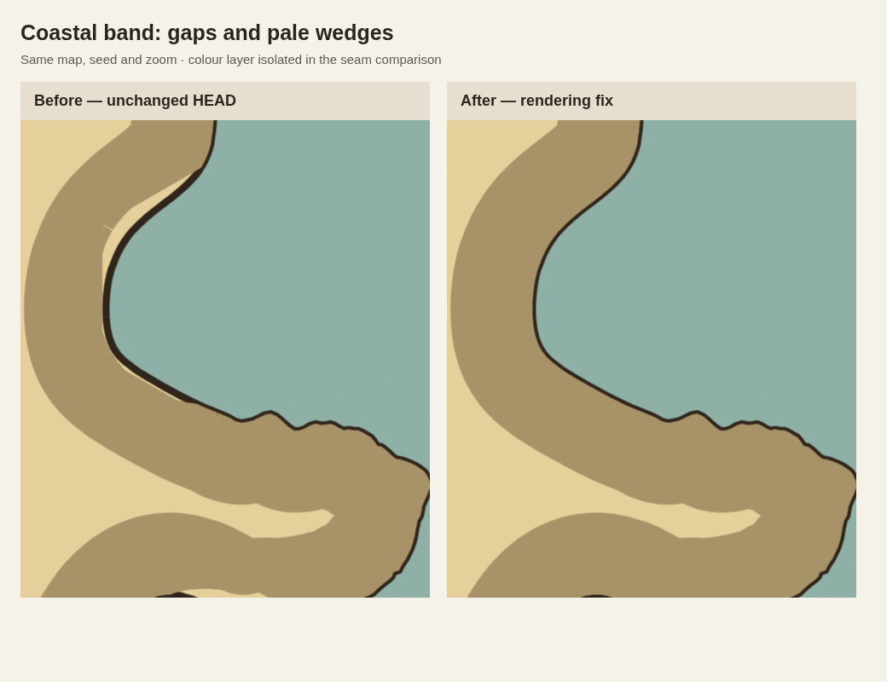
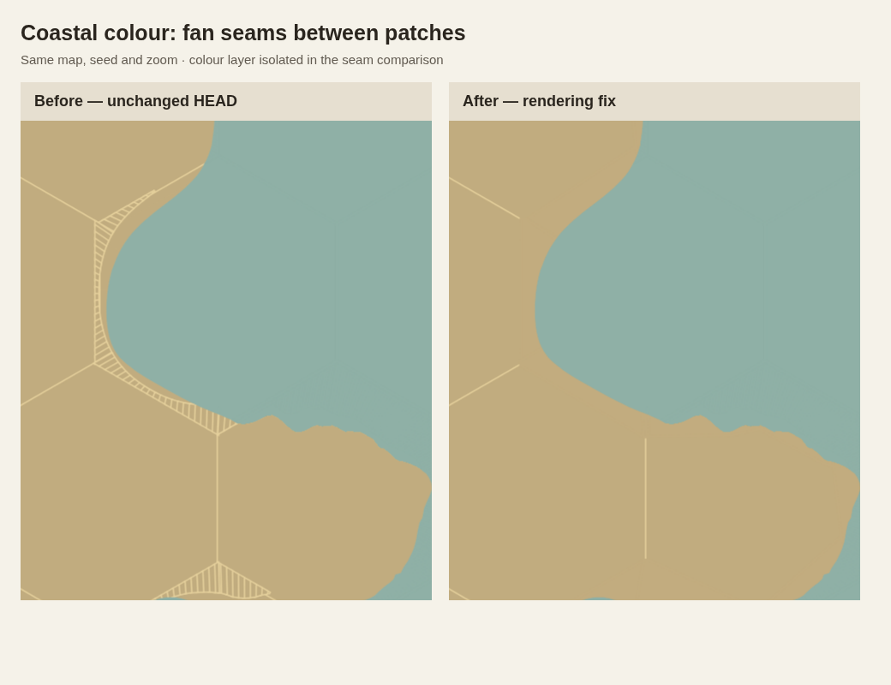

# Coastal paint seams and clipped realm bands

The fix removes the pale fan seams inside coastal colour patches and the pale,
stepped gaps between the coastline and its realm band. The coastline geometry,
land-share fitter and coast detail are retained. These pictures are controlled
reproductions; the saved map behind the user's annotated screenshot was not
provided.





## Introducing changes

Historical render comparisons use the same frozen 7×7 input, `coast-seams` seed,
40-pixel radius, Wavy coast, 70% peninsula land, and one realm. Results below are
Canvas pixels at 4× rasterization, using the independent full-shore-band and
uniform-tint references in `scripts/coast-paint-validation.mjs`. Pixel checks
exclude antialiased shore edges and allow three colour levels of rounding.
Band and tint measurements come from the tint variant.

| Revision | Band gap pixels | Tint seam pixels |
| --- | ---: | ---: |
| Before PR #128 (`24c5927`) | 0 | 0 |
| PR #128 merge (`80a1ca9`) | 205 | 1,372 |
| First fitting commit in PR #138 (`bfe8f27`) | 80 | 1,143 |
| PR #138 merge (`a6572e7`) | 5,442 | 1,800 |
| Current HEAD before this fix (`1179712`) | 5,442 | 1,800 |
| This fix | 0 | 0 |

The two symptoms have related but distinct origins:

* **Fan seams: PR [#128](https://github.com/cmtalleyrand/fantasyhexmap/pull/128),
  component coastline silhouettes.** The component renderer introduced dense
  sampled swept quads in `componentCoast.ts`. The scene painted each patch's
  opaque substrate, sealing stroke, and translucent overlay separately. At the
  shared antialiased edges the overlay did not cover the sealed substrate
  uniformly. Repeating that operation across roughly twenty samples per hex
  edge made the light comb/fan pattern. Older rough-corner rendering also has
  isolated antialiasing defects in some rough fixtures; the dense component
  pattern is first reproduced by this PR. This is not a claim that every
  earlier renderer was pixel-perfect.
* **Large stepped band gaps: PR
  [#138](https://github.com/cmtalleyrand/fantasyhexmap/pull/138), especially
  [`8d5b851`](https://github.com/cmtalleyrand/fantasyhexmap/commit/8d5b8519702ea5928e04718c36324aa08d7177e7),
  “Round strait banks and break up coastal symmetry.”** The preceding coupled
  fit (`bfe8f27`) changed `paths` and `anchors` while retaining pre-fit donor
  patches in `toLand`. `8d5b851` added `skewAlongShore` and seeded off-centre
  swelling, moving much more shoreline beyond those stale patches. The realm
  band stroked the final shore but was clipped to old realm ground plus old
  patches, cutting pale wedges and steps out of it. Smaller donor-ribbon clip
  defects already reproduce in PR #128. The large increase is in PR #138,
  not the later drawing-followup PR #145.

The retained history results include Canvas and SVG counts, plus the final
18-case regression sweep, in `coast-paint-regression-results.json`.

## Repair and cost control

`coastPaint.ts` projects the fitted source-corner anchors onto the final shore,
retains their order, and builds one convex donor envelope per source edge.
The final land silhouette clips these envelopes, preserving bays, capes and
holes. The same envelopes extend realm-band clips, so colour and the realm
band now reach the same final coast. Consistent winding prevents overlapping
pieces from cancelling. A small sealing overlap closes shared boundaries.

Donor paths are grouped and their translucent colours composited once before
painting. Split strait banks, grown land and the component underlay use the
same opaque resolved colour, removing the same alpha seam mechanism there.
The geometric paths and grouped paths use weak caches keyed by immutable coast
geometry, and colours are memoized within each scene build. Ordered sample
hints avoid rebuilding a spatial index on the usual anchor projection path;
a spatial fallback handles removed fold-back loops.

Grouping many patches reduces the number of child primitives even when a
compound path remains dense. Such groups explicitly retain the existing
one-clip Canvas compositor. Counting children alone bypassed that compositor
and made normal-zoom painting slower; the unchanged performance gate rejected
that intermediate approach.

## Verification

* Canvas and SVG: 18 cases covering peninsulas, closed islands and straits;
  Wavy, Ragged and Fractured shores; wash and tint modes. All report zero band
  gaps and zero tint seams. Canvas tests exercise the optimized compositor.
* All 58 test files pass, including donor order/cache invalidation, strait
  geometry and coverage, land placement, map styles, and compositor opacity,
  transform and surface reuse.
* Production build, client/server typechecking and `git diff --check` pass.
* The existing bundle-size warning remains.

Performance gate passed for every measured phase. Paired ratios are used because
cold seeds and edited cells have different construction costs; each after-run
is compared with its matching before-run. The gate retains a 5% timing-noise
threshold with a one-millisecond floor. Every final paired median is faster
than baseline, so none relies on that tolerance to pass.

| Map | Phase | Median paired change | Median paired delta ms |
| --- | --- | ---: | ---: |
| populated | cold | -4.3% | -127.5 |
| populated | warm | -3.7% | -3.2 |
| populated | paint-1x | -11.1% | -11.0 |
| populated | paint-4x-dpr2 | -0.8% | -0.2 |
| populated | edit | -12.2% | -13.9 |
| feature | cold | -2.9% | -78.6 |
| feature | warm | -26.6% | -5.1 |
| feature | paint-1x | -11.1% | -5.3 |
| feature | paint-4x-dpr2 | -2.4% | -0.4 |
| feature | edit | -5.5% | -106.5 |

Negative paired changes mean faster. Standalone medians can order differently
when the slowest seed or a scheduling outlier differs between versions; the
gate compares matching seed/edit pairs rather than two unrelated medians.
Raw samples, standalone medians and per-pair ratios are recorded in
`coast-paint-performance-results.json`.
The paired browser benchmark uses the frozen populated 40×40 map and mixed
30×30 coastal-feature map. It alternates before/after order; measures three
cold seeds, nine warm style redraws, three same-seed base edits, and nine paint
samples per viewport after warm-up. Painting uses the worker's dense-clip
compositor, a 1200×900 surface, 1× and 4× at DPR 2, and pixel readback to include
deferred rasterization. Browser timing is fixture- and machine-specific.

Reproduce from the repository root:

```sh
node --import tsx --test test/*.test.ts
npm run build
npm run typecheck
node scripts/coast-paint-validation.mjs --check
node scripts/coast-paint-performance.mjs --baseline 1179712 --check
```

In managed environments with a separately installed browser/driver, both
browser scripts accept `--chromium /path/to/chromium` and
`--driver /path/to/playwright-core/index.mjs`. Historical runs accept
`--source /path/to/archived/revision --layouts peninsula --irregularities Wavy` on the pixel script.
