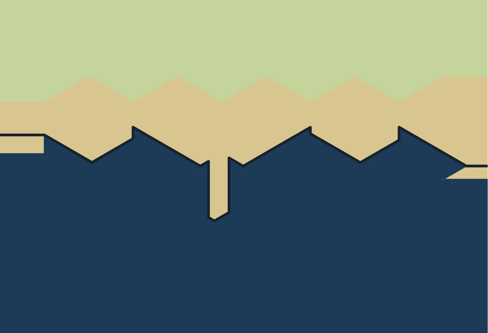
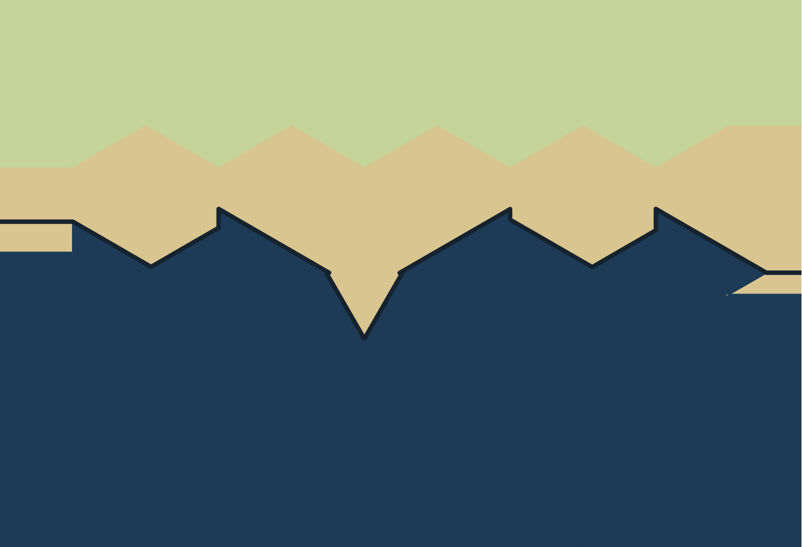
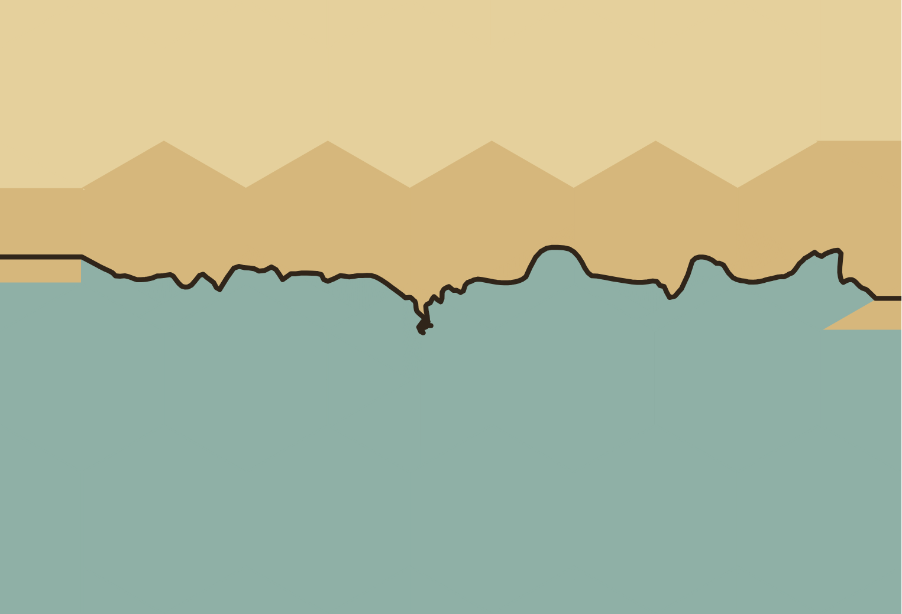
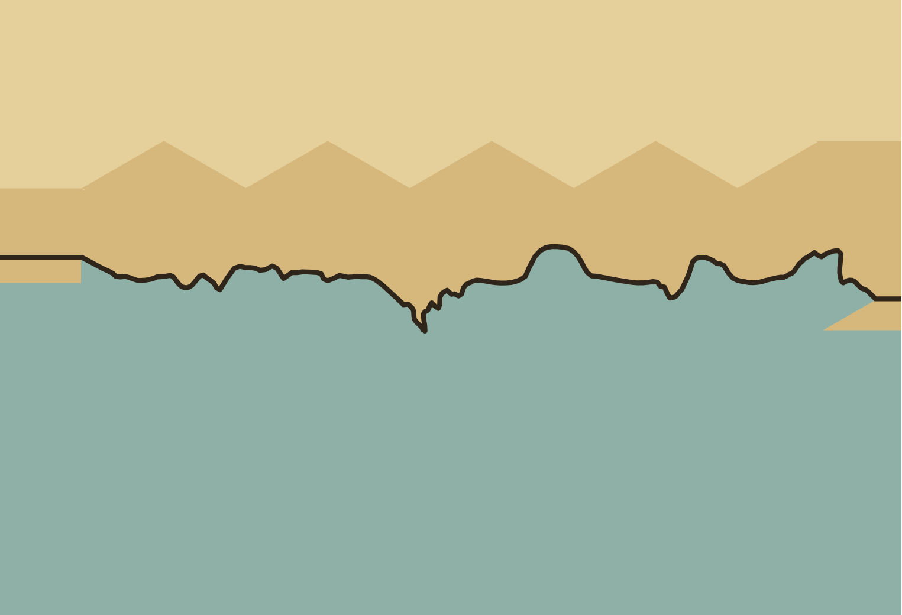
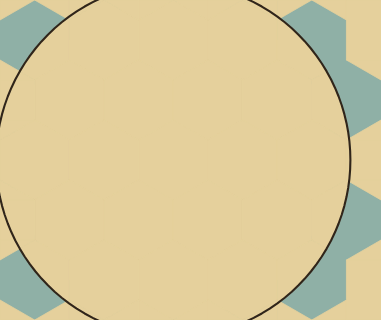
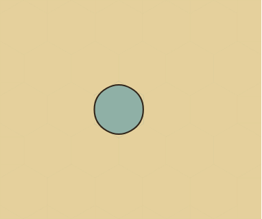

# Drawing follow-up: enclosed seas and repeated redraw work

**Latest connected continuation:** [rounded coast, final redraw measurements and worker study](drawing-followup-connected.md).
That implementation passes the unchanged current-main performance gate. The `f67ca94` measurements
below remain as the earlier failed run, including its scope and limitations.

**Earlier continuation milestone (20 October 2026, runtime `f67ca94`).** Merged current main `1179712`, including #146 and
#147's geographic-name/prompt changes, into this branch. The two pinned area failures are repaired;
the unchanged 150-case raster gate passes (maximum error 0.789 percentage points). The 200 island and
600 enclosed-sea painted checks pass. All 489 Node tests, typecheck, build, 21 finished-picture fixtures
and the 400-seed river rule pass. Current replay and matched performance results are recorded below.
[Machine-readable current evidence](drawing-followup-current-results.json) and the complete
[compressed raw records](drawing-followup-current-records.json.gz) are separate from the historical
pre-rebase [results](drawing-followup-results.json). Remaining work is still listed individually below.

## Current share repair and Canvas control

The Parchment open-chain cleanup now paints **4.635%** for the requested 5%, with no fitting notice.
The Classic unsmoothed coast has no coupled final solver. It exhausted its three measured candidates at
21.275% for a requested 20%. One additional candidate is now permitted **only for unsmoothed coasts still
missing the unchanged one-percentage-point area gate**. It paints **19.211%**, with no fitting notice.
A coast already within the gate keeps its previous geometry; smooth coasts retain their existing rounds.
Numerical regressions read finished fill plus coastline ink, and the independent 4× raster sweep measures
all 150 cases. Maximum errors: Classic 0.789, Parchment 0.484, Atlas 0.493 percentage points.

The extra candidate can retrace an entire coast on an affected cold build; warm redraws retain the exact
coast cache. It is bounded to one extra candidate and keeps the best measured aggregate result. Natural
roughness and exact share are competing constraints near narrow tips: deleting fold-back knots and moving
a cut can alter those tips. Existing crossing, clearance, passage and distortion guards remain binding;
this repair does not promise arbitrarily exact shares or force additional texture into tiny land. The
painted area includes coast ink, whose contribution is substantial at 5%. No owner data, symbol floor or
reporting policy changes.

| Fixture | Current main | Follow-up |
|---|---|---|
| Classic 20% |  |  |
| Parchment 5% |  |  |

The exact replay discrepancy was a comparison with unequal **compiled Canvas path histories**. At export,
fit zoom and DPR 1, the original replay differs in two pixels by one channel level. A two-case control
with identical scene JSON reproduces that; painting the **same scene object** through the two independent
painter bundles still differs in three pixels. Fresh clones on both sides differ in zero. That establishes
a painter/browser history effect independent of geometry or cache reconstruction; the underlying Chromium
implementation detail has not been proved. The worker comparison already used fresh clones.

Export replay now also clones both scene inputs once before the paint matrix. Structured cloning retains
values and within-scene aliases, but removes cross-case identity in the painter's WeakMap of Path2D objects.
Both exact scene and exact RGBA assertions remain unchanged. No production painter, land geometry or
pixel tolerance was changed to address this control defect. This validates geometry-cache replay under
equal painter histories; it does not claim Chromium paints every reused Path2D bit-identically across
arbitrary prior histories.

Reproduce the small history control (add the documented browser override where necessary):

```sh
node scripts/canvas-replay-history.mjs
node scripts/drawing-investigation-extended.mjs --only coverage --preset parchment --seed coverage-2 --share 5 --check
node scripts/drawing-investigation-extended.mjs --only coverage --preset classic --seed coverage-1 --share 20 --check
node scripts/drawing-investigation.mjs --only coast-fit- --check
```

The filters report selected coverage and zero/skipped counts for unrelated groups. Without filters,
the original full coverage and assertions remain enabled. The small fixture runner skips unrelated
river/performance work when filtered. Incidental timings from concurrently running validation scripts
are not used as performance evidence.

## Current validation and performance

**The PR remains a draft: the strict performance gate fails.** The connected runtime implementation
is `f67ca94`; subsequent diagnostic/documentation commits do not change application rendering. Validation:
489/489 Node tests; typecheck and production build; 21 finished-picture fixtures and 400 river seeds;
150 area cases, 200 island cases and 600 enclosed-sea cases. Exact replay passes all 59 edit cases and
944 images with zero scene or pixel mismatches. No assertion or threshold was loosened.

One isolated matched construction benchmark against **current main `1179712`**, Chromium 151.0.7922.173:
five cold seeds; 100 runs per steady-state scenario, first two omitted; alternating before/after order.
No other tests, renders or sweeps overlapped the timing run.

| Scenario | Main median (ms) | Follow-up median | Main p95 | Follow-up p95 |
|---|---:|---:|---:|---:|
| Cold | 2580.1 | 2647.4 | 3066.3 | 2938.1 |
| Warm | 88.9 | 58.5 | 169.1 | 209.8 |
| Ownership edit | 83.9 | 59.2 | 185.0 | 187.2 |
| Shore edit | 125.1 | 89.6 | 249.5 | 194.5 |

Cold median adds 2.6%, within 10%; cold p95 improves 4.2%. Warm, ownership and shore medians improve
34.2%, 29.4% and 28.4%. Shore p95 improves 22.0%, but **warm p95 worsens 24.1% (+40.7 ms) and ownership
p95 1.2% (+2.2 ms)**. The unchanged `--check` fails on warm p95; independently inspecting all scenarios
also finds the ownership failure. These do not satisfy the owner's no-regression requirement.

Profiles show warm tail spikes mostly within land/fill construction, with some outliers in other phases.
They do not establish whether garbage collection, scheduling, allocation or a specific cache caused the
regression. No repeat full run was selected to replace this result. Resolving tail latency remains a
merge blocker; the historical green run is not substituted for it.

These are browser **scene-construction** timings on one populated 40×40 fixture. Ownership/shore states
alternate and become cached. They do not measure unique-edit latency, worker transfer, painting, actual
heap bounds or the deferred 50×50 study. The raw records and scope are retained in current evidence.
The small fixture/pixel runner's incidental timings overlapped other validation and are explicitly not
performance proof. The full benchmark needed the documented `--chromium /usr/bin/chromium` override;
its initial missing-browser launch produced no measurements.

```sh
node scripts/drawing-investigation-performance.mjs --baseline work/current-main --runs 100 --cold-runs 5 --check --chromium /usr/bin/chromium
```

## Isolated cost of the two coast repairs

A separate run, after the full benchmark finished, measures only the two pinned 5×4 maps with geography
visible and all content caches disabled. It alternates before/after order for 50 builds per fixture,
retaining 48 after two warm-up runs. Seed and inputs stay pinned; no painting, fonts, decoration or worker
transfer are included. This is uncached small-scene construction, not populated-map redraw performance.

| Fixture | Main median (ms) | Follow-up median | Main p95 | Follow-up p95 |
|---|---:|---:|---:|---:|
| Parchment 5% | 27.0 | 24.1 | 58.9 | 48.5 |
| Classic 20% | 3.1 | 4.0 | 4.3 | 5.5 |

Parchment median improves 10.7%. Classic adds **0.9 ms (+29.0%)** at median and 1.2 ms (+27.9%) at p95.
The extra conditional candidate is measurable, and its relative cold cost on this tiny fixture exceeds
the owner's 10% requirement. The populated fixture's +2.6% cold median does not excuse this separate
cost. Optimization or owner agreement is still needed before merge; the draft does not claim the
performance requirement is met.

The first small-cost setup accidentally disabled the base layer; its zero-work timings were discarded.
The retained script enables geography and asserts actual coastline construction on every timed build.
No failed timing gate was rerun or replaced. Reproduce:

```sh
node scripts/coast-fit-performance.mjs --baseline work/current-main --runs 50 --chromium /usr/bin/chromium
```

## Historical pre-rebase results

The sections below retain earlier results for context; their green timings do not validate current code.

Baseline: merged main `6786d4a` (#145). The package/browser setup repair is separate in
[PR #146](https://github.com/cmtalleyrand/fantasyhexmap/pull/146). Its Drawing tests CI installed the
pinned Playwright Chromium and passed both commands without driver/browser overrides. A fresh archived
checkout completed `npm ci` and both commands locally with the documented system-Chromium override;
this managed environment blocks Playwright's download host.

This follow-up repairs the enclosed-sea defect identified in the [first investigation](drawing-investigation.md)
and removes repeated exact work in glacier, pack-ice and symbol rendering. DECISIONS.md §§59–60 record
the choices. It does not complete all 17 hypotheses.

## Geography correction

A single Sea hex surrounded by Land became a huge circular coastline. The land mask omitted the page
surrounding a closed water boundary, and aggregate fitting mistook that boundary for an island whose
area should equal all the surrounding mainland. Source-coast direction now distinguishes the two.
Land outside the closed sea belongs to the page; its area is not used to resize the sea.

| Before | After |
|---|---|
|  |  |

The corrected fixture is a small sea within its assigned hex. No owner's data or intended land shares
changed. Two topology/extent tests fail before and pass after. The independent pixel sweep samples the
intended land/water at hex centres, rather than accepting two calculations from the same wrong coast.
Across 200 pinned seeds and three styles, 400/600 baseline cases fail and all 600 corrected cases pass.
Half include a nested land island. Existing island-symbol checks (200 seeds), coast-share checks (150
cases, maximum error below 0.39 percentage points), 19 small drawing fixtures and 400 river seeds pass.

The pre-rebase Node suite passes 469 tests; application typecheck and production build pass. Three
populated all-layer scenes are byte-identical to the baseline. All 59 cached/full edit cases have
identical scene data and zero changed pixels across 944 browser images (zoom, DPR, worker/export modes).

## Exact redraw reuse

The populated benchmark rebuilt nine glacier-margin and sixteen pack-ice components per redraw.
Bounded content caches now retain their exact geometry/primitives. Regression tests compare cached and
uncached scenes after terrain, elevation, roughness, colour, ice-style and size edits. Returning to an
already validated terrain revision no longer repeats every probe for an unchanged symbol fit; a new
revision must still validate every successful and rejected placement probe.

The two new ice caches have four-entry/8 MB estimated storage limits, 16 MB combined extra capacity.
The symbol cache retains its existing 16 MB budget. These are accounting limits, not measured worker
heap/GC results. No approximate land grid or largest-fitting-circle algorithm was introduced.

## Historical performance

Matched browser construction timings against merged main, Chromium 151.0.7922.173; alternating order,
100 runs per steady-state scenario (first two omitted), five cold seeds. The historical strict `--check` passed; the current run above fails.

| Scenario | Main median (ms) | Follow-up median | Main p95 | Follow-up p95 |
|---|---:|---:|---:|---:|
| Cold | 2563.7 | 2580.9 | 3025.6 | 3088.2 |
| Warm | 84.5 | 57.1 | 183.6 | 147.4 |
| Ownership edit | 81.3 | 55.7 | 202.4 | 97.1 |
| Shore edit | 118.4 | 87.6 | 324.9 | 182.8 |

Warm/ownership/shore medians improve 32.4/31.5/26.0%; p95 improves 19.7/52.0/43.7%. Cold median costs
0.7%, p95 2.1%, both below 10%. This resolves the measured gate failure against this main and fixture;
it was not a claim of universally faster maps. These historical timings cover scene construction, not full worker transfer
and painting. Ownership/shore states alternate and become cached; unique-edit and 50×50 measurements
remain outstanding.

Earlier diagnostic configurations are retained in the results JSON: glacier-only reuse still failed
shore p95 (223.7→303.4 ms); adding revision reuse improved shore but failed warm p95 (193→262.5 ms).
Those configurations were not accepted as the finished performance result. The final configuration
also reuses pack ice; its timed run did not overlap other local test/sweep jobs. An unchanged-code
control also showed tail variation, so no single timing result establishes GC causality.

## Status of each hypothesis

G1 = natural/readable geography; G2 = faithful owner control; G3 = useful reports.

| # | Current disposition and evidence | Goal |
|---|---|---|
| 1 | Confirmed, further repaired: enclosed-sea mask includes surrounding mainland. Other query disagreements need broader checks. | G1 |
| 2 | Confirmed/fixed in #145; river-mouth regressions retained. | G1 |
| 3 | Confirmed/fixed for #145's cases; this follow-up preserves exact ice drawing and clipping. | G1 |
| 4 | Deferred: land-derived realm-name anchors need visual validation and cost measurement. | G1 |
| 5 | Partly fixed in #145; border/ripple/sea-ice and complete city-marker raster rules remain unfinished. | G1 |
| 6 | Not concluded: fragments, knots and spurs remain. Closed-water topology was fixed separately. | G1 |
| 7 | Confirmed/expanded: 600 painted topology cases catch a shared geometry/predicate error; all seven principles are not yet covered. | G1, regression protection |
| 8 | Fixed for identified fixtures in #145; new checks pin seeds. | G2, regression protection |
| 9 | Fixed for reproduced routes in #145; 400-seed check passes. Other route families remain. | G1 |
| 10 | Default-dependent drift reproduced and repaired in the continuation; the current 150-case gate passes; enclosed-water fitting error confirmed/fixed. Broader shares and realm/legend areas deferred. | G2 |
| 11 | Visibility concern confirmed/deferred; no new small-feature geometry or warning policy. | G1, G3 |
| 12 | Name-omission reports fixed in #145; furniture/river-loss policy deferred. No routine city/escarpment reports. | G3 |
| 13 | Grouping/severity fixed in #145 and retained; no losses hidden. | G3 |
| 14 | Approved 50% floor retained with its documented omission cost. | G1, G2 |
| 15 | Deferred with #4: beside-name association needs visual validation. | G1 |
| 16 | Symbol-cache survival verified; repeated validation and uncached ice work confirmed/fixed. Worker heap/GC/lifetime measurements remain. | Responsiveness |
| 17 | Deferred: no approximate grid; predicate already has an exact lazy index. 50×50 name/edit/memory study remains. | Responsiveness, G2 |

## Reproduce

```sh
npm ci
npm run test:browser:install
npm test
npm run typecheck
npm run build
npm run test:drawing-pixels
npm run test:drawing-sweeps
```

Archive `6786d4a` into `work/followup-baseline` and link its node_modules to the checkout dependencies:

```sh
node scripts/drawing-investigation-extended.mjs --source work/followup-baseline --output work/followup-extended-before --check
node scripts/drawing-investigation-performance.mjs --baseline work/followup-baseline --output work/followup-performance --runs 100 --check
node scripts/render-incremental-validation.mjs --output work/followup-incremental
```

The first command must fail on that baseline. Performance still rejects any steady-state median/p95
regression and cold costs above 10%. No test, threshold or assertion was disabled or loosened.

## Work not done

Other coast defects outside the repaired loop joins and lake ink in open sea; realm-name anchors;
finished-picture rules for all seven principles; broader island/lake/channel shares and actual
realm/legend area agreement; and omitted-name reports keyed by feature IDs remain. The connected
continuation adds the 50×50 unique-edit worker/heap study; React input scheduling, longer worker
lifetimes and native/Canvas allocations remain outside it. No complaint list is treated as exhaustive.
