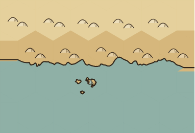
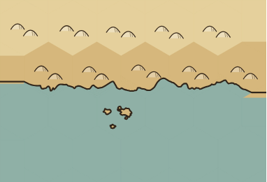
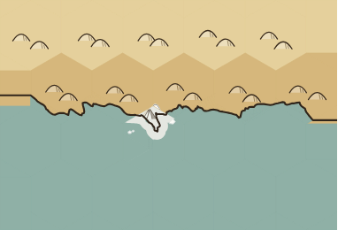
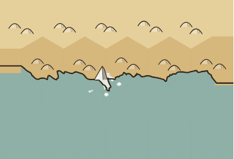
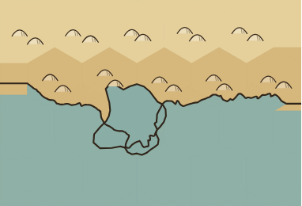
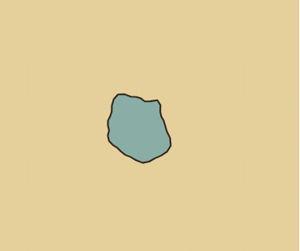
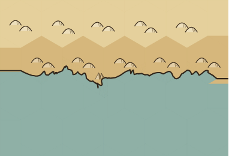
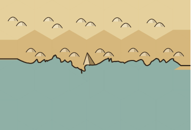

# Drawing investigation: first connected fixes

Investigated initially on `18e4b3a` (#142), then rebased onto `4ff4aa8` (#143). The only rebase conflict was
an import in `scene.ts`; #143's river length/sinuosity measurements remain intact. The owner requested a PR
after a connected set of issues was resolved, with unfinished work explicitly recorded.

This PR repairs the agreement between drawn coastlines, islands/lake islands, river mouths, glacier shading
and feature names. It also repairs seeded gentle-river kinks, applies the owner's approved 50% symbol floor,
and separates meaningful losses from routine adaptations. It does not redesign coastline geometry.

The complaint list remains provisional: the owner was asked what else belongs on it. Subsequent explicit
clarifications are binding here: cities belong on dry ground without a routine notice; escarpments must
clearly lie within land, also without a routine omission notice.

## Results, one per hypothesis

G1 = natural, readable map; G2 = predictable owner control; G3 = useful reports. “Deferred” includes work not
completed at this PR boundary; it is not a claim that the issue is harmless.

| # | Finding and disposition | Evidence and limits | Goal |
|---|---|---|---|
| 1 | **Confirmed; repaired for this connected set.** | Island ellipses disagreed with painted outlines; lake-island curves were ignored; river mouths used another predicate. All use the painted outlines/shared land answer now. Also repaired lake-donated coast patches painted as water. Other drawing branches still need a complete inventory. | G1, G2 |
| 2 | **Confirmed; fixed.** | A point at `(20.11, 10.09)` beyond the tip of the test triangle is water, but the old nearest-segment predicate calls it land. River mouths now use the shared full outline; a pinned low-share mouth render exercises the integration. | G1 |
| 3 | **Partly confirmed; fixed where reproduced.** | Glacier shelf shading leaked 2,283 opaque pixels into painted water; it now has the coast clip. Escarpment ink and intermediate stretches now clear the shore. The inspected shared-hex and hillshade renders are protected by clipping/paint order. The per-hex-overlay inventory is not exhaustive. | G1 |
| 4 | **Confirmed in source; deferred.** | Realm candidates and beside-name bounds still use hex centres. A review-only prototype samples drawn land; it changes the pinned small realm's name from `(266,160)` to `(90,140)`, but is not established as cheaper or consistently better. No production label-anchor change is included. | G1 |
| 5 | **Confirmed; partly fixed.** | A long name for a one-hex lake painted over surrounding land (1,108 white-mask probes); it is now fitted or omitted with a notice. The sea-name variant also fails on baseline. River labels use the common surface constraint. Added audit rules for river names over water and city marker centres. City names over sea remain legitimate. Raster checks for borders, ripples, sea ice and complete marker footprints remain. | G1 |
| 6 | **Refuted in inspected renders; no geometry change.** | Continuous coast ink at normal and 4× zoom in the pinned coast example; current component tracing differs substantially from #118. This is limited visual evidence, not an exhaustive fragment/topology sweep. | G1 |
| 7 | **Confirmed; independent check added for repaired cases.** | Existing audit passed the fractured-island symbols that touched painted sea. A separate Chromium black/white geography render catches that and the shelf leak, and fails against the baseline. This is not yet an independent check of all seven principles. | G1, regression protection |
| 8 | **Confirmed; fixed in the identified render fixtures.** | Fifteen render-test files now use deterministic map IDs unless explicitly overridden. The formerly single-seed gentle-river check has a 400-seed companion; no threshold was relaxed or test disabled. #143's new sinuosity fixture already pins its seed. | G2, regression protection |
| 9 | **Confirmed; fixed for the reproduced failure.** | 80/400 baseline seeds fail the unchanged 60° rule; none leave their hexes. All 400 pass after local wander retraction; the 320 previously valid courses are byte-identical. A further 4,000 runs across the two gentle levels pass. Other routes still warrant sweeps. | G1 |
| 10 | **Ordinary-coast drift refuted in measured cases; broader work deferred.** | 150 painted-area samples across Classic/Parchment/Atlas and ten seeds: maximum error below 0.39 percentage points. A constrained isthmus asks 10% but shows about 74% and already reports it; the fractured island example shows about 12.14% for 10%. Legend areas remain data-derived; drawn realm/legend agreement and broader lake/channel/island sweeps are unfinished. | G2 |
| 11 | **Visibility concern confirmed; geometry and warning policy deferred.** | The 5–10% coast and Very narrow/Normal strait images show how much ink dominates small features. No coastline or passage geometry changed, and no new routine warning is imposed. The approved symbol floor addresses relief readability separately. | G1, G3 |
| 12 | **Meaningful omissions confirmed; river/water-name reports fixed.** | Requested names that cannot fit are now reported. Per owner clarification, cities placed onto dry ground and escarpments stopped at water do not generate notices. Furniture-margin and river-shore alignment reporting were not expanded; distinguishing actual losses there remains an open policy/task. | G3 |
| 13 | **Confirmed; grouping and severity added.** | The 200 isolated-island renders all produced fitting notices. The Inspector now separates adaptations and losses, groups equal notices and puts losses first. A test groups 100 adaptations plus a loss without losing hexes. No threshold hides losses. | G3 |
| 14 | **Confirmed visually; fixed with owner's approval.** | Before/after 30% versus 50% images were presented; the owner chose 50%. The fitting floor is now 50%, with fewer/larger marks or omission rather than unreadable tiny sets. | G1, G2 |
| 15 | **Confirmed in the pinned small-realm example; deferred with #4.** | The current beside-name slot is determined by the hex extent. The review prototype changes the name's side and distance, but has not established reliable association across low-share realms and archipelagos. | G1 |
| 16 | **Cache-survival hypothesis refuted on current main; memory measurement deferred.** | Warm populated renders record 539 symbol cache hits and no new searches. Fitting now uses bounded content caches; the worker retains the scene module and retained inputs. Cache eviction is bounded, not immediate disposal on every coast edit. No new cache architecture or measured GC/worker-heap study is included. | Responsiveness |
| 17 | **Not concluded; deferred.** | Current `evenOddTest` already has a lazy exact two-dimensional edge index, so the old linear-query cost model is stale. The proposed approximate land grid was not introduced. The requested 50×50 ownership-edit/memory comparison remains to be done. | Responsiveness, G2 |

## Finished-picture evidence

The browser command saves each scene as SVG, a normal-size PNG, a black/white land mask, and selected 4×
views. The renderer paints the mask with the same geometry and ink widths; feature placement does not
classify these pixels. Area measurements include coastline ink, while symbol rejection uses unambiguously
black water pixels. Ordinary-coast area measurements use 4× resolution over 150 cases.

The initial lake disagreement was diagnosed twice: a first test wrongly expected the disputed point to
be water. Tracing successive painted primitives showed the shared outline was right and a later lake-colour
patch was wrong. The test was corrected to expect dry shore, the painter was fixed, and the independent
pixel check was strengthened to reject predicate/paint disagreement. No existing rule was relaxed.

Before/after assets and machine-readable results are included beside this report. Review-only label-anchor
prototypes are generated by `--proposal labels`; that switch modifies the diagnostic bundle, never source
files or test expectations. The 50% symbol prototype became production only after the owner's approval.

| Reproduction | Before | After |
|---|---|---|
| Fractured-island fitting |  |  |
| Glacier shading outside its coast |  |  |
| Lake-donated shore patch |  |  |
| Long name on a small lake |  |  |
| Owner-approved symbol floor |  |  |

The remaining knots/spurs visible on the [4× coast](drawing-investigation/coast-4x.png), and overlapping
lake-shore ink beyond the mainland in the lake-patch example, are existing geometry defects that this PR
does not repair. The isolated `Sea` cell fixture also exposes an inflated enclosing coast rather than the
intended small water body. Its label is now kept off painted land, but that does not make its geography
correct. These need topology/fitting regressions against the owner's intended geography, in addition to
predicate/paint agreement. They are not excused by the passing image check.

The approved floor has a substantial omission cost on fragmented tiny land. In the 200-seed isolated,
fractured, 10%-land island sweep, the 30% floor retained 187 mountain symbols in total; the 50% floor retains
10. All affected examples retain a fitting notice. The owner's terrain data and island geometry are
unchanged. This is the chosen readability trade-off, not a claim that tiny mountains now remain visible
on every island. The floor is shared by the relief/vegetation fitter and elevation marks.

## Validation and performance

The rebased Node suite passes 464 tests across 55 test files, including #143's river measurements. Typechecking
and the production build pass. All 19 finished-picture fixtures pass; the archived main fails the same
check. The 59-case cached/full browser comparison has zero scene or pixel mismatches across 944 image
comparisons. The additional 200-seed island pixel sweep passes, as does the 150-case ordinary-coast area
check. Three all-layer scenes are byte-identical before/after the clip-reuse optimization.

**Performance remains a merge blocker.** Final measured browser scene-construction times in milliseconds:

| Scenario | Main median | PR median | Main p95 | PR p95 |
|---|---:|---:|---:|---:|
| Cold, five seeds | 3020.2 | 3042.9 | 3106.9 | 3262.5 |
| Warm, 98 measured runs | 128.0 | 99.4 | 297.5 | 216.1 |
| Ownership edit, 98 measured runs | 115.6 | 89.3 | 228.7 | 252.6 |
| Shore edit, 98 measured runs | 146.6 | 131.8 | 288.4 | 356.2 |

Cold median cost is +0.75%, p95 +5.01%, both below 10%. Warm/ownership/shore medians improve 22.3%, 22.8%
and 10.1%. Warm p95 improves 27.4%, but ownership p95 regresses 10.5% and shore p95 23.5%. The strict
`--check` command therefore **fails**. No performance assertion is skipped or loosened. An earlier long run
had the opposite tail pattern (warm p95 regressed while ownership/shore p95 improved), so GC/scheduling
variation needs investigation, not a declaration that the final failures are harmless. The PR is a draft;
the owner's no-slowdown constraint is not claimed satisfied.

In absolute terms, the slower edit tails add 23.9 ms for ownership and 67.8 ms for shore changes.
These are occasional additional waits, while typical construction is faster. The shore difference can
be noticeable during editing; it is not evidence of an overall average slowdown or a measured paint delay.

The report's JSON retains the short run, the earlier long run and this final run rather than selecting
only favourable timings. These are construction timings with browser fonts loaded, not an end-to-end
worker-transfer/paint latency measurement. Ownership and shore states alternate and become cached;
unique-edit and worker/painter latency still need separate measurement.

Benchmarks use the repository's frozen populated 40×40 map, alternate before/after order, preserve warm
caches, and cover cold builds, warm redraws, ownership edits and shore edits. Cold uses five map seeds;
other scenarios use 100 runs in the final comparison, with the first two omitted from steady-state statistics. The baseline is
the exact rebased `main`, not the old #118 branch. The cache/full-rebuild browser runner additionally compares
painted pixels and scene data after its edit sequence, across worker/export compositing, zooms and DPRs.

The scripts emit raw profiles under `work/`; this report does not call warm redraws “instant”, claim the
50×50 benchmark was done, or treat synthetic timing improvements as evidence of universally faster maps.
The independent audits have zero app-time cost. The production changes add outline/label probes and an
escarpment stroke check; per-build island path reuse and bounds checks offset repeated layout work.

## Reproduce

Install the repository dependencies and provide a Playwright Core driver if it is not installed locally.
The managed environment used `/opt/codex/runtimes/cua/lib/node_modules/playwright-core/index.mjs` and
`/usr/bin/chromium`. Chromium needs the environment's normal browser/socket permissions.

```sh
node --import tsx --test test/*.test.ts
npm run typecheck
npm run build
npm run test:drawing-pixels -- --driver /path/to/playwright-core/index.mjs
npm run test:drawing-sweeps -- --driver /path/to/playwright-core/index.mjs
```

Archive the chosen baseline into a scratch directory and link its `node_modules` to the working checkout's
installed dependencies, as the repository's comparison scripts do. Then:

```sh
node scripts/drawing-investigation.mjs --source work/baseline --output work/before --check --driver /path/to/playwright-core/index.mjs
node scripts/drawing-investigation-performance.mjs --baseline work/baseline --output work/performance --check --driver /path/to/playwright-core/index.mjs
node scripts/render-incremental-validation.mjs --output work/incremental --driver /path/to/playwright-core/index.mjs
```

The first baseline command is expected to fail on `4ff4aa8`: it reproduces the defects being repaired.
The current checkout's pixel/seed check must pass. The matched performance command fails if any steady-state
median or p95 slows down, or cold construction exceeds the baseline by more than 10% on either measure.

## Explicit remaining work

Finish the independent finished-picture rules for borders, ripples, sea ice, complete city markers,
ownership shares, edit locality and all remaining drawing principles. Resolve the strict ownership/shore
tail-latency performance failure before merge. Expand the topology/fragment sweep,
repair coast knots/spurs, enclosing Sea loops and lake ink in open sea; expand mixed lake/sea and island-share
fitting measurements, realm colour/legend area agreement, and river-route
families. Decide and validate land-derived realm-name anchors with the owner. Measure 50×50 low-share
ownership edits and worker memory/GC before proposing further land-query caches. Improve omission reports
to use feature IDs when distinct features have identical names.
