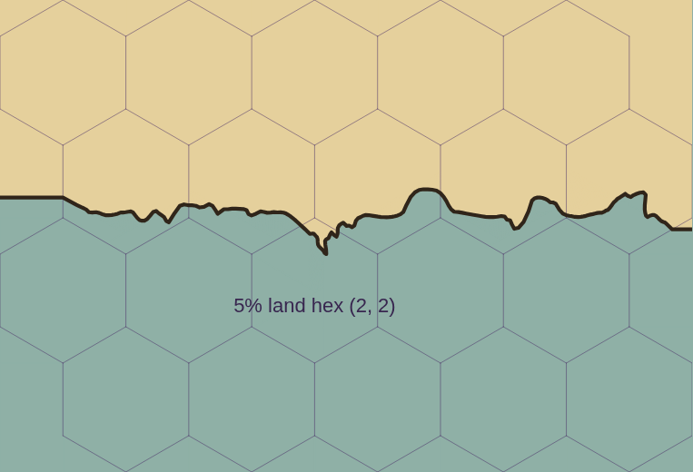
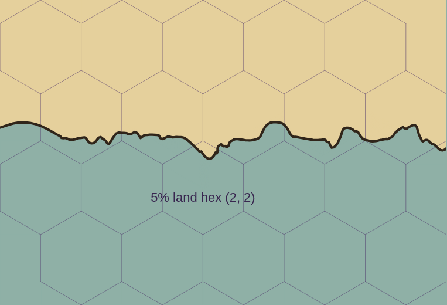

# Drawing status and evidence

**Latest working state:** drawing optimizations pass correctness checks but still fail
the strict performance gate. They remain an unaccepted working draft; see
[the current disposition](#current-disposition-correctness-passes-performance-acceptance-remains-blocked).

Reviewed 21 October 2026 on `codex/default-coast-comparisons`, against code at
`12a33d7e8472d193d8c37939941ceeea5ca8ebc8` (merged PR #156), after rebasing the initial
review of `849f12f` (#148). This consolidation changes
documentation only. Read this record, [the work plan](drawing-work-plan.md), and
[DECISIONS](../DECISIONS.md) before further drawing work.

The shared finished coastline, rounded cape/rim repair, exact redraw reuse, coastal seam fixes
and exact realm-colour boundaries are present, together with lake-strait, concentration and limited
generated-island controls from PRs #149/#154–156. Editing latency, land-derived realm-name anchors,
complete independent paint coverage, and broader control fidelity remain unfinished. No current-head
performance pass is established by this review.

## What was stale

| Superseded document | Assessment after source/history review |
|---|---|
| `drawing-followup-connected.md` | Its 20 October rebase qualification was correct. The measurements belong to runtime `be084b1` versus `6f3d5c7`, before the rebase onto `fd8d2f6`. The body still names retained geometry in `coastPaint.ts`; that helper is now `coastPaintGeometry.ts`. Its remaining-work list needed the newer realm-boundary coverage distinguished from missing border-ink containment coverage. |
| `drawing-next-agent.md` | Wrong working branch, several obsolete milestones and test totals, and unqualified “current-main” benchmark claims. It prioritised anchors before diagnosing the larger feature-name/paint costs. |
| `drawing-investigation.md` | Useful first-investigation evidence, but its active merge blocker, missing worker study and inflated enclosed-sea defect were superseded. Its original 17 findings needed reconciliation with later fixes. |
| `drawing-followup.md` | Also superseded: mixed historical and “current” sections, draft/merge-blocker language, earlier sea/coast results and already completed worker-study tasks. |

These four narrative documents have been removed after consolidation. Their original text is available
through Git (for example, `git show 849f12f:docs/drawing-followup-connected.md`). Raw results, failed
measurements, compressed records and renderer images remain in place. Filenames containing “current”
are historical artifact names, not statements about today's head. The initial local `origin/main`
was stale at `c40f4f1` (#126). It has now been fetched to `12a33d7`; the consolidation rebases cleanly
onto that main. Earlier measurements have not been relabelled as measurements of the new code.

## Applied solutions and whether they succeeded

| Work present in source | Evidence of success and remaining limit |
|---|---|
| Painted island/lake paths and river mouths share `landAt`; glacier shelf gets the coast clip; lake-donated shore ground is painted correctly. `scene.ts`, `rivers.ts`, DECISIONS §§52–54. | Original failing-before checks caught four wet symbol points, 2,283 wet shelf pixels and 13 lake predicate/paint disagreements. Retained after results remove these reproduced failures. This does not inventory every drawing branch. |
| Gentle river wander retracts locally only where it creates a ≥60° kink. | Original 80/400 failures became zero; the 320 already-valid courses stayed identical. Further retained runs covered 4,000 cases across two gentle levels. Other route families are not proved safe. |
| Names fit their drawn surface or are omitted; reports distinguish adaptations/losses. Symbol floor is 50%. | Long water-name failures were repaired; requested omissions are reported. The 200 tiny fractured-island examples retained 10 mountain symbols versus 187 at the old 30% floor: an approved readability cost. Duplicate-name omission reporting still uses text rather than feature identity. |
| Enclosed-water orientation distinguishes sea holes from land islands. `coast.ts`/`scene.ts`, §60. | 400/600 baseline topology failures became zero. The sweep checks intended land/water at cell centres, including nested islands; predicate agreement alone could not catch this defect. Do not reopen the inflated Sea loop as an unfixed diagnosis. |
| Open fold-back loops removed; one conditional fourth unsmoothed fitting candidate; post-skew loop-join rounding and tangent page continuation. `coastCorners.ts`, `rim.ts`, §§61–62, 67. | Retained full area sweep: 150 cases within the unchanged one-percentage-point gate (maximum errors Classic 0.789, Parchment 0.470, Atlas 0.440 pp); 200 island and 600 enclosed-sea cases pass at the recorded continuation version. Pinned rounded 5% cape paints 4.6726%. This is finite fixture evidence, not a universal geometry guarantee. |
| Border-notch fills clipped to final land; all preset land-colour defaults uniform. §§65–66. | Recorded Canvas comparison removes detached rim fragments. Explicit coastal-band choices remain supported. Classic retirement is only a direction, not a completed migration. |
| Exact ice, symbol, island and coast-paint reuse. `ice.ts`, `islandDrawingCache.ts`, `coastPaintGeometry.ts`, `scene.ts`. | Node reconstruction checks and retained exact replay support reuse. Ice budgets total 16 MB estimated, island scale/drawing budget 4 MB estimated; these are not allocation measurements. The coast-paint derivatives share the existing 20 MB coast budget. Placement caching already exists; see the work plan before adding another cache. |
| Equal painter histories in replay; independent JavaScript heaps in comparison benchmarks. §63, §69. | Identical scene objects could differ by 2–3 pixels with unequal Path2D histories; fresh clones eliminated this control defect without changing production painting or exact assertions. Separate benchmark isolates remove cross-version GC attribution, not production GC pauses. |
| PR #152: resolve opaque ground colours, group translucent donor paint, fit donor envelopes to final coast. `coastPaint.ts`. | Retained 18-case Canvas/SVG seam/band sweep passes. Earlier child-count compositor selection caused a paint regression and was rejected. See [seam investigation](coast-paint-fix.md). |
| PR #153: exact shared realm boundaries, preserve holes, exclude neighbouring and unowned regions from donor extensions. `realmBoundary.ts`, `scene.ts`. | Retained 18-case Canvas/SVG sweep checks 15,225 probes per renderer with zero realm-colour errors. It excludes ink pixels and uses land predicates to select probes; it does not independently prove all border ink stays on painted land. See [boundary investigation](realm-boundary-fix.md). |
| PR #149: short lake straits between independently varied headlands, local shore-field joins and visible flank irregularity. `lakePassage.ts`, `lakeShoreField.ts`, `scene.ts`. | Merged numerical regressions cover continuity after ink, widths, junction side, crossings, local editing and cache/undo. High land targets such as 80% retain the natural shape and report the actual share instead of forcing a canal. [Retained review](lake-straits-review.md) is historical visual-review text; the PR is now merged. Natural appearance is not proved by geometry checks. |
| PR #154: independent endpoint depths on a single-edge coastal cut, solving mean depth to preserve area. PR #155: lake concentration direction and measured-ink fitting. | [Concentration evidence](coast-concentration.md): 24 default-style coastal scenes, maximum outlined-coast error 0.271 pp; 54 plain-Land-neighbour lake scenes, maximum 0.500 pp. These are retained outline/ink measurements, not a fresh independent finished-pixel area sweep. Zero concentration preserves the control path. |
| PR #155: isolate each comparison SVG in its own image document. | Cross-panel clip/pattern ID collisions caused apparent painted spill; 42 gallery panels match standalone screenshots after isolation. This comparison defect was repaired without changing the standalone coastline. The Coastal Land-neighbour experiment separately retains 29 area failures and 3 direction failures across 54 scenes; that coupled fitting problem remains open. |
| PR #156: source-faithful prompts and limited generated island settings. `generatedIslands.ts`, generation/import/reducer paths. | Optional island counts, arrangement, orientation and irregularity now reach map state across API/chat paths; manual land shares/layout controls are preserved, incompatible old terrain settings dropped, and undo/redo covered. Generated arbitrary land shares are not introduced. [Automatic coasts and terrain families](automatic-coasts-next-steps.md) remain a separate planned migration, not an implemented fix. |

## Visible evidence retained

These are actual Canvas renders of the same synthetic pinned map, with the full grid including water.
They are historical comparisons, not fresh renders of this head or captures of the owner's saved map.

| Rejected cape/page join | Rounded production proposal |
|---|---|
|  |  |

Other original before/after images remain under `drawing-investigation/` and `drawing-followup/`.
They document the initial island, shelf, lake, water-name, symbol-floor and enclosed-sea repairs.
Do not use their grid-free views as the sole evidence for a new geography or anchor change.

## Performance: version boundaries matter

All figures in the following two tables are **pre-rebase** evidence for runtime
`be084b1a4b054acfd7b48c357ccc654019ff33ea` versus main
`6f3d5c755d8666731f21e62d9073e939cbd68a66`, Chromium 151.0.7922.173.
They are not measurements of `fd8d2f6`, rebased PR #148, `849f12f` or current main `12a33d7`.

The final independent-heap 40×40 construction gate passed: five cold builds and 100 per steady-state
scenario, first two steady-state samples excluded, alternating order, no concurrent heavy work.

| Construction ms | Baseline median / p95 | Candidate median / p95 |
|---|---:|---:|
| Cold | 2667.3 / 3347.1 | 2688.7 / 3267.0 |
| Warm | 92.6 / 199.3 | 46.7 / 80.1 |
| Ownership | 92.7 / 205.9 | 45.7 / 77.1 |
| Shore | 126.9 / 269.2 | 76.3 / 157.7 |

The separate 50×50 production-worker harness used 32 cumulative unique ownership edits, sequential
version lifetimes, all layers/names, bitmap transfer and two animation frames. It bypassed React input
and Inspector scheduling. Its measured viewport was 1400×900 at DPR 1.

| Unique-edit ms | Baseline median / p95 | Candidate median / p95 |
|---|---:|---:|
| Build roundtrip | 615.1 / 782.4 | 482.3 / 593.9 |
| Displayed sharp frame | 1086.4 / 1614.4 | 937.7 / 1341.7 |
| Worker viewport paint | 466.5 / 861.4 | 437.3 / 845.9 |
| Realm-name placement | 14.8 / 20.3 | 9.1 / 20.4 |

Candidate construction averaged 493.5 ms: 403.7 ms feature-name placement versus 11.6 ms realm names.
Source still keys the whole river-label family on all ordered realm/city obstacles. A moved realm
name can therefore repeat river searches even when courses are unchanged. This supports a focused
diagnostic, not a claim that 404 ms remains the measured current cost or that realm anchors dominate.
Painting retains a substantial historical tail and needs its own causal profile.

The separate forced-GC pass retained 76.91 MiB after cold, 74.05 after warm, and
84.44/86.17/86.67/86.74 MiB after 8/16/24/32 edits; baseline ended at 88.73 MiB.
Embedder heap was about 12.96 MiB for both after editing. These observations exclude Canvas/GPU/native
memory and do not prove a lifetime bound or attribute memory to individual caches. Memory-pass timings
are diagnostic, not benchmark samples.

Failed runs remain material evidence:

- Initial #145 final comparison: ownership and shore p95 regressed 10.5%/23.5%.
- Glacier-only reuse failed shore p95; adding revision reuse still failed warm p95.
- `f67ca94` versus `1179712`: warm p95 169.1→209.8 ms, ownership 185.0→187.2 ms.
- Shared-heap `a7d9b03` versus `6f3d5c7`: shore p95 249.6→278.2 ms despite a faster median.
- Classic's separate tiny-fixture cold cost was +0.9 ms / +29%; large-map gains do not erase it.

Raw artifacts are unchanged: [initial results](drawing-investigation-results.json),
[early follow-up](drawing-followup-results.json), [later failed run](drawing-followup-current-results.json)
and its [records](drawing-followup-current-records.json.gz), plus
[connected results](drawing-followup-connected-results.json) and [complete connected records](drawing-followup-connected-records.json.gz).
The connected JSON identifies sweep/replay runtime `3471968` separately from final timing runtime
`be084b1`; do not flatten those into one validation claim. Rebase commit `1abc064` reports 502 Node
tests, typecheck/build, focused seam checks and all 18 boundary cases passing after integration.
The pre-rebase 944-image replay was not rerun on that rebased head.

## Checks performed for this consolidation

At the initial `849f12f` review, source, Git history, scripts, retained experiments and result metadata
were inspected. Five focused
Node files pass: `drawingInvestigation`, `incrementalRender`, `labelPlacement`, `realmBoundary`,
and `coastPaint`. This includes exact cached/full scene checks; it is not a new full-suite result.

An eight-edit 50×50 worker diagnostic was attempted but produced **no samples**. The checkout's
default Playwright import failed; using the installed alternate driver reached Chromium, which
terminated on sandbox-denied `setsockopt`. A request to run with added permissions was cancelled.
No browser sweep, new renderer image, timing comparison or memory result is claimed for this head.
[Review records](drawing-status-review-records.json.gz) retain the command outcomes and test log.

The subsequent rebase review reads all intervening PRs through #156 and their source/retained evidence.
Eleven focused Node files pass: the original five plus `coastConcentration`, `lakeConcentration`,
`lakeStraitRendering`, `generatedIslands`, `promptAlignment` and `webchatImport`. Client/server
typechecking also passes. No browser or performance measurement was repeated for the rebase.
These checks are recorded separately in that archive, preserving the initial results and failed launches.

## Reconciled original investigation items

| Item | Current disposition |
|---|---|
| 1: inconsistent land answers | Reproduced island/lake/mouth/sea-hole cases repaired; complete branch inventory remains open. |
| 2: river-mouth predicate | Shared finished land replaces the failed nearest-segment test. |
| 3: shading/overlays at shore | Shelf/escarpment and later seam repairs present; coverage is finite. |
| 4: realm anchors | Open: candidates and beside bounds still substantially derive from hex centres. |
| 5: wrong-surface names/decorations | Name repairs present; entire markers, ripple/ice/border ink checks incomplete. |
| 6: coast fragments/knots | Open fold-backs, rim spill and pinned cape repaired; other old spur/lake-ink observations need current reproduction before diagnosis. |
| 7: independent checks | Expanded by topology, seam and realm-colour checks; all seven principles are not fully covered. |
| 8: unpinned fixtures | Identified render fixtures pinned; continue pinning new cases. |
| 9: gentle-river kinks | Reproduced route family repaired; broader routes still unproved. |
| 10: control fidelity | Ordinary-coast gate retained. Single-edge coast and plain-neighbour lake concentration repaired in #154/#155; lake-strait controls in #149. Coupled Coastal Land-neighbour lake fitting has retained failures; broader islands and painted realm/legend agreement remain open. |
| 11: small-feature ink/readability | Concern remains; do not change shares or add blanket warnings to hide it. |
| 12: omission reports | River/water reports present; duplicate-name identity, furniture/river loss policy remain open. No routine city/escarpment notices. |
| 13: notice volume | Severity/grouping present, losses retained. |
| 14: symbol size | Approved 50% floor present; omission cost disclosed. |
| 15: small-realm association | Open with item 4; review prototype is not production. |
| 16: cache survival | Existing exact caches survive eligible edits; short worker-heap study exists. Longer/native lifetime evidence remains absent. |
| 17: predicate/edit costs | Exact lazy edge index already exists; no approximate grid introduced. Worker study exists historically; current feature-name and paint costs need diagnosis. |

## 23 October 2026: editing-cost continuation

The first diagnostic ran on `a903a60` (#157, runtime inherited from #156). Fetching
main then discovered #158; the implementation and final checks use
`4e0db34` as their baseline. This is a new version boundary, not validation of
#158 by the earlier diagnostic. No geography or anchor changes are proposed here.

**Diagnosis.** Installed Chromium 151.0.7922.173 and the Playwright-core driver at
`/opt/codex/cua_node/lib/node_modules/playwright-core/index.mjs` work with additional
execution permission. The default missing-driver failure and sandbox `setsockopt`
failure are retained. One 50×50 worker lifetime with eight cumulative unique edits,
1400×900 viewport, DPR 1, all names/layers and profiling enabled measured build
roundtrip median 445.1 ms and viewport paint median 307.7 ms. This is diagnostic,
not a p95 gate or React input-to-display measurement.

The separate instrumented run on that same pre-#158 source averages 357.79 ms of
river candidate search versus 10.75 ms preparation per edit. Every edit executes
52 course preparations and 4,428 candidates / 119,556 point probes, including the
compatibility and surface-fallback passes. River cache-key serialization averages
0.28 ms and cache writes 0.26 ms. Compatibility timing contains nested preparation
and candidate timings: do not add those overlapping sections. The original full
result cache still hits for range, water and area names during these edits.

**Distinct implementation.** After checking the existing placement cache and
nearby-river point index, add conservative bounds for realm/city and earlier-river
letter boxes. A point outside a rectangle's enclosing L1-radius square cannot be
inside its rotated box. Rounding slack makes this rejection conservative; survivors
still use the unchanged `insideBox` predicate. Keep box order, candidate order,
scoring, tie breaks and both surface passes. Earlier-river boxes are snapshotted
anew before each river, after the previous river has appended its glyph boxes.
This does not retain previous winners or add a preparation/result cache.

Opt-in profiling now separates river preparation, candidate scoring, surface
validation and compatibility search, and each name family's cache serialization,
cloning and placement. The worker harness retains paint/overview profiles, source
and bundle fingerprints, viewport/driver settings and launch/runtime failures.
The replay harness accepts an archived `--baseline` for an independent old-code
reference rather than only comparing two instances of current code.

**Correctness.** All 67 Node test files pass through `node --import tsx --test
 test/*.test.ts`; `npm test` itself first failed on the sandbox's denied tsx IPC
socket, before tests ran. Client/server typecheck and production build pass.
The new rotated-box test exercises edges, rotations and tiny/large coordinate
scales against the original predicate. The profile test checks unchanged output
with and without surface fallback. Browser placement replay against archived
`4e0db34` passes 20 scenes and 320 images with byte-identical scene JSON and zero
changed pixels, including ownership/name/course/shore/font and map-switch edits.
Replay timing overlapped validation and is not performance evidence. Full drawing
area/topology sweeps were not repeated for this collision-only change.

**Failed gate and disposition.** The isolated 40×40 comparison ran after validation
finished, with five cold builds and 100 samples per steady scenario (first two
excluded), alternating versions in distinct JavaScript isolates. Values are ms:

| Scenario | Main median / p95 | Candidate median / p95 |
|---|---:|---:|
| Cold | 2920.8 / 4019.4 | 2824.0 / 3951.9 |
| Warm | 26.3 / 49.3 | 26.5 / 46.0 |
| Ownership | 25.2 / 42.6 | 27.1 / 48.7 |
| Shore | 66.4 / 129.5 | 63.5 / 114.1 |

Warm median and ownership median/p95 fail the unchanged gate. The conservative
obstacle optimization and its dedicated test were **reverted**; its exact source
patch and raw failed measurements are retained. Do not attribute these regressions
solely to broad-phase checks: repeated ownership states can hit the whole-result
cache, and this run does not establish a causal allocation/GC explanation. No
repeat was used to select a favourable result. The final change retains only the
profiling, diagnostic harness improvements and profiling-transparency regression.
The 320-image comparison and full suite above describe the rejected candidate;
post-revert checks are recorded separately. No editing-speed improvement is claimed.

Next: use the retained diagnostic to investigate scoring/allocation on cumulative
unique ownership edits, while preserving the strict paired gate. Paint path/group
and compositor allocation attribution, changed-obstacle attribution, land-derived
anchors, independent layer coverage and broader control fidelity remain unfinished.

**Final diagnostic-only validation.** After reverting the optimization, the three
focused files (`renderProfile`, `incrementalRender`, `drawingInvestigation`),
client/server typecheck and production build pass. A fresh isolated eight-edit
50×50 run on `4e0db34` plus final diagnostics completes successfully, retaining
both viewport and overview profiles for every frame. River candidate search still
averages 291.96 ms per edit versus 9.50 ms preparation; build roundtrip median is
353.3 ms and viewport paint median 308.6 ms. These are a new diagnostic's numbers,
not evidence of an improvement over the earlier source or a passed performance gate.

Raw reports, failed launches, rejected source patch, final diagnostic patch,
version fingerprints, exact replay records and validation logs are retained in
[drawing-editing-diagnostics-records.json.gz](drawing-editing-diagnostics-records.json.gz).
The uncompressed working outputs are `work/worker-diagnostic-before/`,
`work/worker-diagnostic-profiled/`, `work/worker-diagnostic-final/`,
`work/river-replay/` and `work/river-performance/`. No final speedup is claimed;
the completed part of priority 1 is executable, versioned cost diagnosis.

## 23 October continuation: exact obstacle rotation preparation

**New evidence, not a retry of the rejected broad phase.** An ownership-only V8
CPU sample (`render-worker-study.mjs --cpu --span 50 --edits 8`) on `4e0db34` plus
the retained diagnostics attributes about 1814 ms of sampled self time to
`insideBox` across eight cumulative unique edits. This is the largest named
JavaScript leaf cost; native bitmap transfer/drawing also remains substantial.
CPU-sampled times are diagnostic, not benchmark samples. The harness now saves
`ownership.cpuprofile` and prohibits combining CPU sampling with forced-GC mode.

The new proposal snapshots each ordered obstacle's coordinates/extents and computes
`cos(-rotation)` and `sin(-rotation)` once per search. Every point still executes
the original multiply/add/absolute-value comparisons, including inclusive edges.
There is no bounding-box rejection, epsilon, approximation or persistent cache.
Avoidance boxes are prepared per pass; earlier river glyph boxes are prepared again
before each subsequent river. Candidate order, surface fallback and score order
remain intact. This differs from the discarded enclosing-square broad phase.

**Benchmark control.** Inspection of the prior failed gate's raw records shows
98/98 retained warm, repeated-ownership and shore samples hit the whole river-label
result cache in both versions, with zero river searches. Those records cannot
attribute the regression to point checks. The next comparison uses archived
`4e0db34` plus the same pre-existing diagnostics in both versions, identified by
`work/river-scoring/start.patch`, to avoid timing different instrumentation.
All old scenarios and thresholds remain; the new `unique-ownership` scenario
makes cumulative edits to distinct owned Land hexes (423 eligible in the pinned
40×40 fixture) and rejects requests that exceed that supply. Separate heaps,
alternating order and warm-up exclusions remain unchanged.

**Correctness at this proposal.** All 67 Node test files pass, as do client/server
typechecking and the production build. The new exact-query regression compares
tilted edges at small, ordinary and large coordinate scales, verifies inclusive
corners and checks that a new search sees changed obstacles while an existing
snapshot stays immutable. Browser placement replay against the instrumented
pre-change archive passes all 20 scenes / 320 images, with identical scene JSON
and zero changed pixels. This covers the actual prepared-rotation implementation,
not just the earlier rejected broad phase. Full geography sweeps were not repeated:
no coast/land/ownership/anchor geometry changes are made by this proposal.

**Prepared-rotation gate: failed, retained.** Five cold and 100 per steady scenario,
independent heaps and matched diagnostics produced the following ms. Unique edits
improve, but cached ownership p95 and shore median/p95 fail; this is not a pass.

| Scenario | Baseline median / p95 | Rotation proposal median / p95 |
|---|---:|---:|
| Cold | 2867.4 / 4095.1 | 2714.0 / 3892.1 |
| Warm | 27.8 / 51.7 | 26.5 / 49.5 |
| Repeated ownership | 27.1 / 48.4 | 27.0 / 60.6 |
| Shore | 66.5 / 123.3 | 70.1 / 183.3 |
| Unique ownership | 122.2 / 200.6 | 80.5 / 166.7 |

## Allocation and invalidation follow-up

A separate 30-run warm/shore diagnostic samples V8 allocations, including collected
objects, after the first two builds. These estimates are allocation traffic, not
retained heap or native memory; its timings cannot establish a performance gate.
Warm sampled traffic is approximately 794/808 MB (baseline/proposal), shore
1520/1486 MB. `symbolAnchor` and its point walker account for roughly 60 MB of warm
traffic. They build a complete sampled-point list and a second x-only array just
to compute horizontal bounds. A streaming implementation preserves all original
x-coordinate and midpoint arithmetic, including empty/nested drawings, without
allocating those lists. The independent audit's `samplePoints` stays unchanged.

The shore records also show `ice.packBuilds: 1` on every alternating edit, despite
`coast.cacheHit: 1`. Pack generation contributes substantial sampled allocations
through `icePlates` and its coast outline. Reviewing `seaIcePrims` identifies its
actual dependencies: ordered ice hexes and their irregularities, land-side booleans,
seed, size/dimensions, colours and texture/organic modes. The old key includes the
entire base/hex-shape arrays, causing unnecessary invalidation for Land ↔ Coastal
Land edits that leave those pack inputs unchanged. A proposed exact-input key
retains the 4-entry / 8 MB estimated budget; it neither grows the cache nor reuses
the finished water clip. The clip remains fresh for changed shoreline geography.

`drawing-investigation-performance.mjs --diagnostic cpu|allocations` retains
per-version/per-scenario samples and rejects `--check` in sampled mode. It is a
diagnostic mode, not a replacement for natural paired timings. First-two-build
exclusion applies to sampling as well as the ordinary steady-state summaries.

**Connected streaming/key proposal: failed gate, retained.** Its full 68-file suite,
typecheck/build and 20-scene/320-image exact replay pass. The unchanged paired gate
still fails: cold 3016.0/4432.3 → 3184.9/4213.3 ms (median/p95, within the cold
allowance); warm 28.9/53.9 → 30.4/53.3; repeated ownership 25.9/39.9 → 29.2/55.3;
shore 67.3/139.0 → 36.5/63.7; unique ownership 121.5/171.4 → 81.4/151.2.
The shore/unique gains do not erase the warm/ownership failures. Source and all
records remain under `work/river-scoring/connected-performance/`.

**Anchor refinement.** A separate small Node diagnostic over mountain/conifer
symbols finds the streaming traversal essentially level with the original:
11.72 versus 11.59 ms median per batch of 2,000 repeated symbol sets, excluding
the first two batches. This is not a browser or tail-latency gate. Streaming still
walks the whole drawing a second time, after the audit has sampled it already.
Replace it with build-local reuse of those exact audit points via a WeakMap keyed
by the placed drawing. `symbolAnchor` retains its original calculation and accepts
optional precomputed points. Nothing is cached across redraws; audit sampling,
point order, anchor arithmetic and the external default call remain unchanged.
The next gate tests this materially different traversal removal, not another run
of the failed streaming code.

**Audit-point reuse gate: failed, retained.** Validation passed (68 test files,
typecheck/build and 320 exact replay images), but the gate still fails. Median/p95
ms: cold 2892.3/4452.2 → 3173.6/4021.4; warm 26.6/41.7 → 27.9/50.1;
repeated ownership 24.1/34.6 → 26.8/47.3; shore 64.7/104.0 → 36.2/90.0;
unique ownership 117.2/185.4 → 77.7/160.3. Cold median is +9.7%, within the
10% limit, but the warm/ownership regressions remain disqualifying. Raw source,
metadata and results are in `work/river-scoring/reuse-performance/`.

**Cached-drawing follow-up.** A separate 40-run CPU diagnostic over warm and
repeated-ownership scenarios finds substantial garbage collection (about 345 ms
sampled self time across 38 retained warm builds), plus repeated `hash32`, `mix`,
vegetation drawing and `refit` work. The fitting cache remembers where symbols
fit but deliberately regenerates all drawing primitives to refresh colours.

The next proposal keeps a single colour-keyed immutable drawing alongside each
validated fitting. Seed/grid/size/hex/elevation/cover remain in the fitting key;
the actual ground and ink colours form the additional drawing key. Land probes
still validate all failed candidates before a fitting can be reused. A changed
fit regenerates the drawing; changed colours regenerate it without repeating the
land search. Callers receive fresh placed-object wrappers for hex metadata, while
label fading wraps scene primitives without mutating the cached drawing.

Drawings and their keys are charged to the existing 10,000-entry / 16 MB estimated
symbol-fitting budget. There is no additional persistent cache or enlarged budget.
Only illustrated relief/vegetation uses this path; the marks path retains its
existing behaviour. Counters distinguish `symbols.drawingHits` and
`symbols.drawingBuilds`. Tests cover colour/geometry invalidation, exact uncached
reconstruction and preservation of a previous scene after later edits.

## Current disposition: correctness passes; performance acceptance remains blocked

The bounded-drawing proposal passes all 68 Node test files, client/server typecheck,
production build, and 20-scene / 320-image exact replay. The final accounting-only
change also charges the drawing key string to the existing budget; the full suite
was run after that adjustment. No geography or anchor position changes are intended.

The new independent-heap gate (five cold builds, 100 samples per steady scenario,
first two steady samples excluded, no concurrent validation or sampling) **fails**:

| Scenario | Instrumented baseline median / p95 | Current draft median / p95 |
|---|---:|---:|
| Cold | 2888.6 / 4766.6 | 3074.7 / 4434.0 |
| Warm | 31.4 / 52.4 | 32.8 / 56.5 |
| Repeated ownership | 28.7 / 46.4 | 30.6 / 49.1 |
| Shore | 73.2 / 161.4 | 31.4 / 77.0 |
| Unique ownership | 134.7 / 191.3 | 84.0 / 143.7 |

All figures are scene-construction milliseconds, not end-to-end app latency.
Cold median +6.4% is within the allowance; warm and repeated-ownership
median/p95 regressions are disqualifying. The last run confirms 539 drawing cache
hits and zero drawing rebuilds per warm sample, so the new reuse is exercised.
Warm `scene.symbols` median falls 8.05→5.25 ms, but other phases and timing tails
absorb the saving. Mean total warm construction is approximately 34.94→34.83 ms;
that does not replace the required median/p95 gate or establish a GC cause.

**Disposition:** retain the source as an unaccepted, unmerged working draft, with
all failed measurements. Do not describe the drawing work plan or its performance
gate as complete. Prepared obstacle rotations, exact pack-input keys, build-local
audit-point reuse and bounded illustrated drawings are reviewable proposals.
The next investigation should explain the cached redraw distribution (including
border construction and GC/retained-memory effects) before another connected fix.
Do not rerun the same code to select favourable timings or loosen the threshold.

All continuation records, CPU/allocation samples, rejected and current patches,
source fingerprints and validation logs are appended to
[drawing-editing-diagnostics-records.json.gz](drawing-editing-diagnostics-records.json.gz).
Working files are under `work/river-scoring/`; `drawing-performance/` identifies
the latest failed gate, distinct from `performance/`, `connected-performance/`
and `reuse-performance/`. These finite construction/replay checks do not establish
full drawing-sweep, long-lived/native-memory or React input-scheduling coverage.
