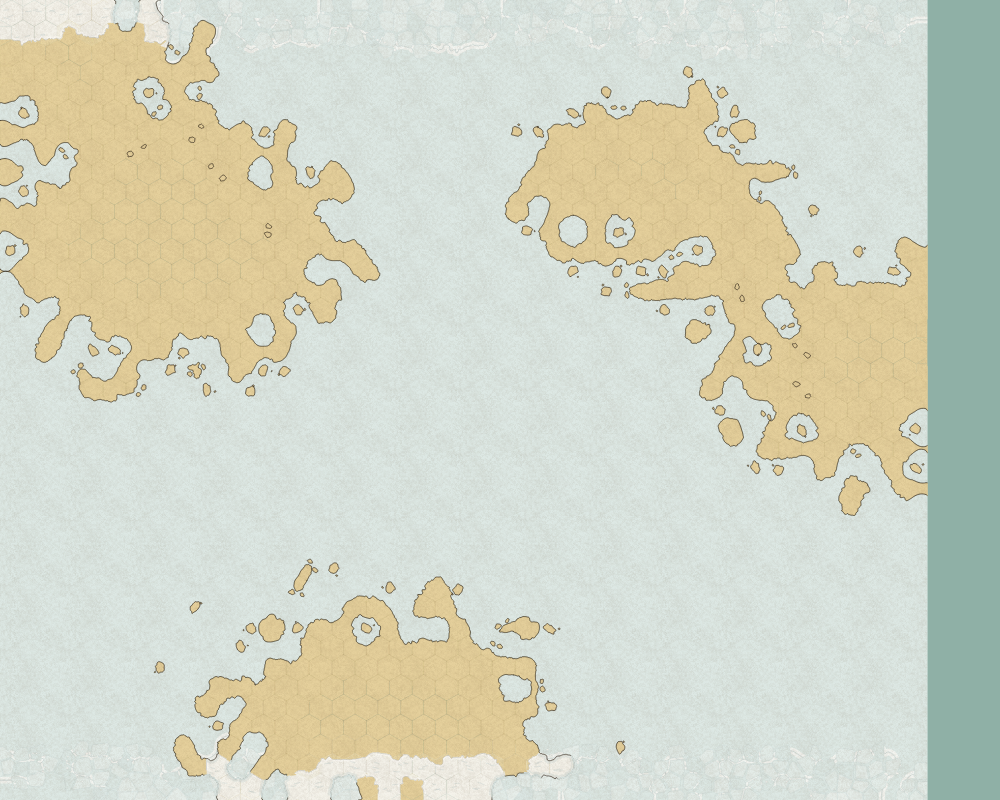
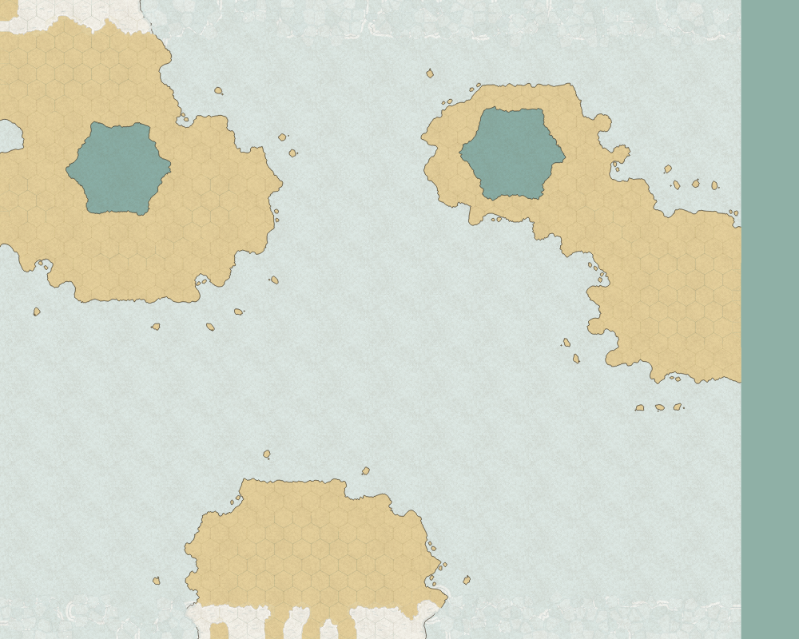
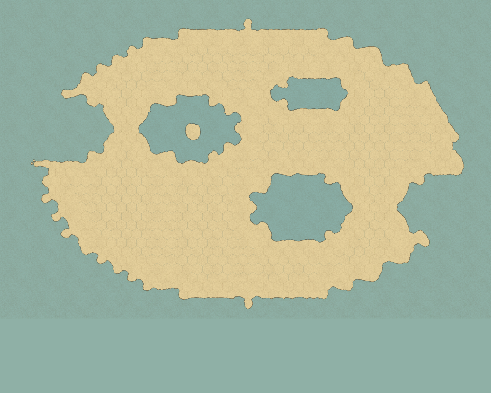
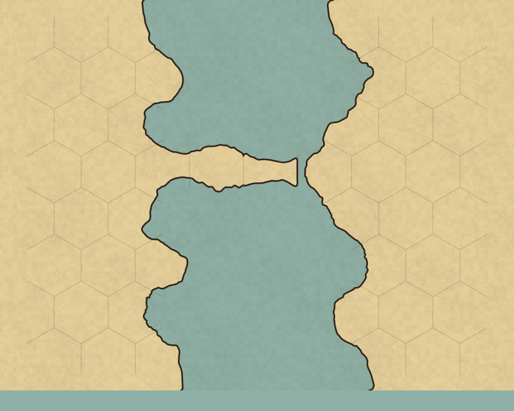
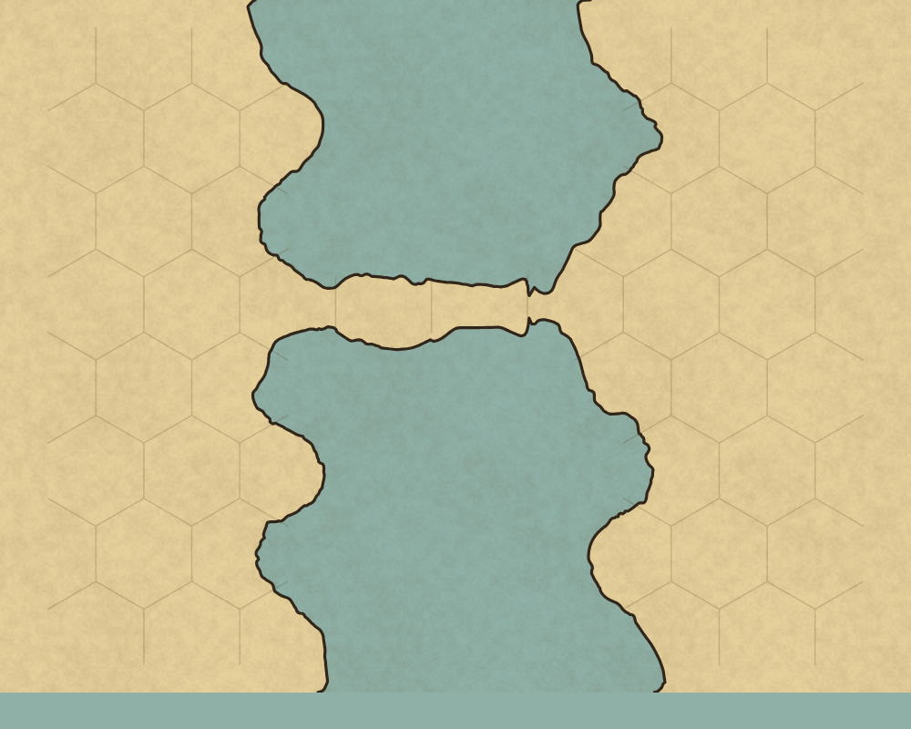

# Coherent geography inputs and connected drawing

The populated benchmark now uses coherent coast types, offshore islands separated from the coast,
and two multi-hex inland lakes. These pictures use the same renderer on the previous and corrected
inputs; they show a workload correction, not a performance comparison.

| Previous input | Corrected input |
|---|---|
|  |  |

The large-continent review fixture covers a connected continent and three substantial lakes. Only
the western lake contains an island.

The next comparison uses the same corrected isthmus input with the parent and updated renderers.
The old drawing cuts the neck off from the right bank; preserving the coastal join restores the
connection. The internal topology regression tests check that connection.

| Parent renderer | Corrected renderer |
|---|---|
|  |  |
