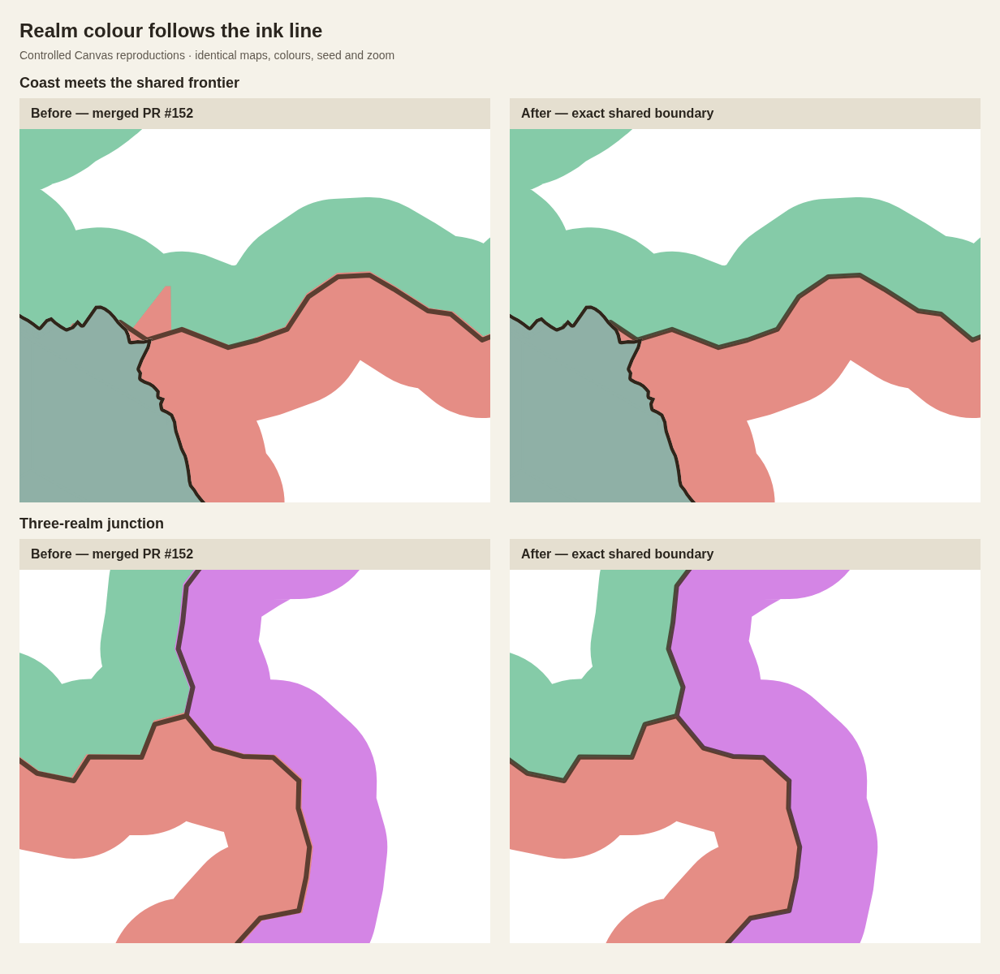

# Keep realm colour on the drawn frontier

The follow-up screenshot exposed a gap in PR #152's verification: all coastal
pixel fixtures used a single realm. They proved coastal coverage and removal
of fan seams, but could not detect a realm's colour crossing its neighbour's
frontier. The small pixel mismatch at shared borders was also not covered.

The remaining causes were:

- The realm clip followed a wandering frontier, returned to the original hex
  corner, and then scaled the whole polygon by 1.03. The painted colour edge
  therefore differed from the ink path. This predates PR #152 (`3ef8607f`), but
  is incompatible with exact border alignment.
- PR #152's convex coastal donor envelopes were also used to extend political
  ownership clips. An envelope can overlap an existing neighbouring realm;
  clipping only to the coastline does not prevent that spill.

`realmBoundary.ts` traces the union boundary of owned cells from the exact
shared edge points used by the border. It cancels internal edges, retains holes,
and does not enlarge the region or insert a detour to an old corner. Both
sides of a shared edge use the same wandering path, including when the other
side is unowned land.

Coastal fill envelopes still repair donor ground and preserve the seam fix.
When they extend a realm's band clip, exact existing neighbouring and unowned
land regions are excluded. Bounding boxes skip neighbours that cannot meet
any of the extension patches. Region outlines, supplemental paths and inverse
masks are computed once per scene and reused by its band and underpaint.



## Regression checks

`scripts/realm-boundary-validation.mjs` uses two- and three-realm coastal maps,
straight/ragged/wild frontiers, and wash/tint/fill modes. It tests Canvas's
optimized compositor and exported SVG independently. The expected colour is
computed from the realm colour and style opacity. Probes on both sides of the
actual ink line catch pale gaps, overlap blending and wrong-realm paint.

Additional dense probes directly around the three-way junction use independent
source-cell polygons following the shared ragged edges to identify the rightful
realm. Points occupied by the ink itself are excluded from colour comparisons.

The original screenshot is not available as a saved map. These are controlled
reproductions of the shared-border failure, not an edited copy of the screenshot.
The exact assertions are retained and can be run against the merged PR #152
source via `--source work/realm-before` to demonstrate the failures.

The final sweep checks 15,225 probes per renderer across 18 cases, with zero
colour errors after the correction. Raw before/after results are retained in
`realm-boundary-regression-results.json`.

`test/realmBoundary.test.ts` also checks a region with an unowned hole and
subpixel probes on opposite sides of a ragged shared border. The original
18 coast/island/strait Canvas/SVG guards still pass.

Validation: all 60 test files, production build, client/server typechecking and
whitespace checks pass. The build retains its existing bundle-size warning.

Performance is compared with merged PR #152 (`a42b1a6`) using the same paired
cold-build, warm-redraw, edit, normal-paint and zoomed-paint benchmark and the
unchanged five-percent/one-millisecond gate. Raw samples and results accompany
this document.

```sh
node --import tsx --test test/*.test.ts
npm run build
npm run typecheck
node scripts/realm-boundary-validation.mjs --check
node scripts/coast-paint-validation.mjs --check
node scripts/coast-paint-performance.mjs --baseline a42b1a6 --check
```

The browser scripts accept `--chromium` and `--driver` for managed environments.

The final performance gate passes in every phase. Median paired changes:

| Map | Phase | Change |
| --- | --- | ---: |
| populated | cold | -4.7% |
| populated | warm | -10.8% |
| populated | paint-1x | -2.8% |
| populated | paint-4x-dpr2 | -7.9% |
| populated | edit | -4.6% |
| feature | cold | -1.9% |
| feature | warm | -24.0% |
| feature | paint-1x | -3.8% |
| feature | paint-4x-dpr2 | +0.6% |
| feature | edit | +0.8% |

Raw samples are in `realm-boundary-performance-results.json`. Small positive
changes on the feature map are below one percent and within the existing gate.
